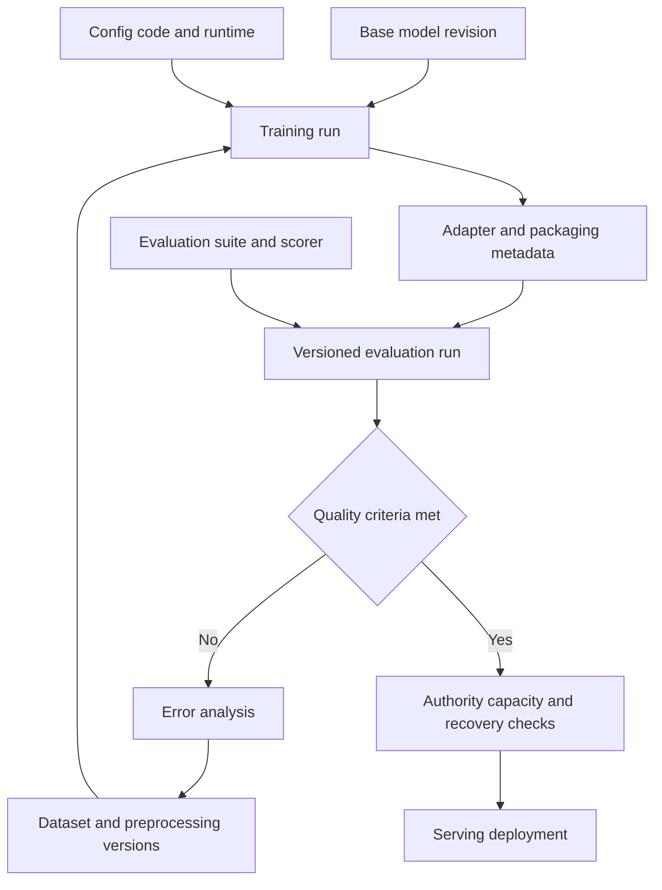

# Chapter 10. End-to-End Fine-Tuning Platform Architecture

The models and settings are study examples, not results of training, evaluation, or deployment.

<!-- SOURCE CORE START -->

## 10.1 Full Structure

A training platform is a lab notebook. Link data, code, settings, artifacts, and evaluation to each run for traceability, while treating production release as a separate decision.

Connecting the content of this session gives the following structure.

```text
Raw Data / Documents
↓
Data Cleaning / Curation
↓
Training Dataset
Validation Dataset
Golden Dataset
↓
Dataset Versioning
↓
Training Request
↓
Choose base model
+
QLoRA Config
↓
GPU Training Job
↓
LoRA Adapter
↓
S3 Artifact Storage
↓
Model Registry
↓
Golden Dataset Evaluation
↓
Quality Gate
├─ FAIL → Error Analysis → Improve dataset → Retraining
└─ PASS
     ↓
Model Serving
     ↓
vLLM / Serving Engine
     ↓
Production
```

**Quality Gates and Production Release**

The source's `PASS → Model Serving` shows the next step for a candidate that meets quality criteria. It does not automatically guarantee deployment authority, model compatibility, capacity, readiness, or rollback preparation. Recommendation: link the exact artifact to be deployed to its evaluation results. Check the separate approval, capacity, and recovery conditions defined by the operations owners. [AI platform architecture](../platform-infrastructure/architecture.md) and [CI/CD and GitOps](../platform-infrastructure/cicd-gitops.md)

A golden set used repeatedly for comparison and error analysis influences model selection. Separate fixed regression suites from independent final holdouts as described in sections 8.3, 8.5, and 8.7–8.8 of [Model developer](model-developer.md).

---

## 10.2 Core Objects from a Platform Perspective

Main objects to manage in an AI fine-tuning platform:

```text
Base Model
Dataset
Dataset Version
Training Config
Training Run
Adapter Artifact
Evaluation Run
Evaluation Result
Model Version
Deployment
```

It is important to link these objects.

**Traceable Runs and Identical Results**

The source links between model, dataset, configuration, code, and artifact are a starting point for tracing runs. Also record preprocessing and data order, tokenizer/template, dependencies and CUDA environment, hardware, seeds and RNG state, and deterministic settings. PyTorch does not guarantee fully reproducible results across releases, platforms, and devices. Matching seeds alone does not ensure identical artifact bytes or metrics. Define acceptable metric variation and rerun conditions first. [PyTorch reproducibility](https://docs.pytorch.org/docs/stable/notes/randomness.html)

---

## 10.3 Reproducible Training

A good platform should let you reproduce past training runs.

Example:

```text
Training Run #1024

Base Model
→ Qwen revision X

Training Dataset
→ train-v12

Validation Dataset
→ validation-v12

Training Config
→ qlora-config-v4

Code Version
→ git commit abc123

Artifact
→ adapter-v7
```

This information should let you rerun training under the same conditions.



---

## 10.4 A Structure That Supports Model Replacement

The pipeline itself remains in place even when the base model changes.

```text
Llama
↓
Training Dataset v12
↓
QLoRA
↓
Adapter A
↓
Golden Evaluation
```

New model:

```text
Qwen
↓
Training Dataset v12
↓
QLoRA
↓
Adapter B
↓
Same golden evaluation
```

Then compare the results.

```text
Quality
Latency
Cost
GPU Memory
Throughput
```

Use this comparison to choose the base model for production.

**Pipeline Reuse and Model Compatibility**

Reusing the same logical pipeline does not mean applying a Llama adapter directly to Qwen. Check the target model's module structure and shapes, LoRA target modules, tokenizer and chat template, truncation and loss masking, and serving support. The same raw conversation can require different control tokens and formatting for each model. [PEFT LoRA configuration](https://huggingface.co/docs/peft/package_reference/lora), [Transformers chat templates](https://huggingface.co/docs/transformers/chat_templating)

Recommendation: keep golden evaluation tasks and scoring criteria consistent while using each model's required input format. For latency, throughput, and cost comparisons, record the GPU, precision, context length, concurrency, generation settings, and warm/cold state. Do not infer model quality differences from different serving conditions.

---

<!-- SOURCE CORE END -->

## Key points

Trace each training run through its data, code, settings, and artifacts; treat production release as a separate validation and approval step.

## LLM in Practice: Review Run Reproducibility and Production Release

**Prompt:**

=== "한국어"

    ```text {.prompt}
    후보 adapter가 평가 기준을 통과했어. 실행 기록으로 같은 산출물을 추적할 수 있는지, 평가한 파일과 배포 후보가 같은지, 운영 전환에 필요한 근거가 있는지 검토해 줘. 점수만으로 배포를 승인하지 말고 실제 변경은 실행하지 마.
    ```

=== "English"

    ```text {.prompt}
    A candidate adapter passed evaluation. Review whether the run records trace its artifacts, whether the evaluated file matches the release candidate, and what evidence is still needed for production. Do not approve release from the score alone or apply changes.
    ```

**Key point:** A review table and minimal change candidates that distinguish missing reproducibility records, artifact/evaluation links, evaluation independence, and production-release conditions. It may assume matching seeds guarantee identical results, treat an adapter as the complete base model, or confuse passing golden scores with deployment approval. Compare actual run records, environments, checksums, and evaluation inputs and outputs. Compare reruns using predefined tolerances. Verify production-release conditions through authorized procedures and isolated tests. This example is not a record of training, model responses, or measured quality improvements.
