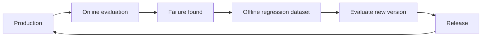
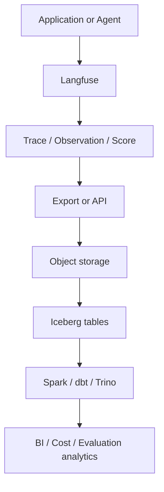

# Chapter 16 — AI Evaluation Data Platform

This page records conceptual study of sections 16.1–16.12. All data, scores, costs, versions, and gates below are hypothetical teaching examples, not production measurements or implemented results. Online evaluation observes real executions. Offline evaluation compares changes with fixed cases. Turning failures into regression cases and linking executions to version bundles connects the two flows.

<!-- SOURCE CORE START -->

## 16.1 Online Evaluation Events

Real requests are hard to recreate exactly, so inspect execution records together with feedback. If a score is low, inspect its trace ID together with the prompt, model, and tools to decide where to investigate. A score alone does not prove the cause. Do not count unscored requests as successes.

> **Evaluating AI executions that actually happened in production and attaching evaluation data to those traces.**

Basic flow:

```text
User Request
   ↓
Agent
   ↓
LLM / Tool
   ↓
Response
   ↓
Evaluation
```

Possible evaluation events:

```text
thumbs_up / thumbs_down
rating
user_feedback
llm_judge_score
rule_based_score
error_type
```

A score alone does not show which execution produced it.

Bad:

```text
score = 0.4
```

Better:

```text
trace_id
execution_id
agent_version
prompt_version
model_version
score
feedback
```

Linking the execution and evaluation helps investigate:

```text
Why was this response bad?
Which prompt was used?
Which model generated it?
Which tools were called?
Which agent release produced it?
```

In Langfuse, a trace can link the following information for one execution. This conceptual view helps trace a low score back to its prompt, calls, and response.

```text
Langfuse Trace
 ├─ Prompt
 ├─ LLM Call
 ├─ Tool Call
 ├─ Response
 └─ Score / Feedback
```

### User feedback

The simplest online evaluation attaches a user reaction to a response:

```text
Response
  ↓
👍 / 👎
```

More detailed forms may include:

```text
rating = 1~5
reason = inaccurate
comment = "wrong tool was selected"
```

### Automatic evaluation

Rules or evaluator models can also check responses from real requests.

```text
Response
 ↓
LLM Judge
 ↓
Score
```

or:

```text
Response
 ↓
Rule Check
 ↓
Pass / Fail
```

Checks may include:

- Is generated SQL executable?
- Is a required citation present?
- Does the output contain prohibited information?
- Does the response follow the expected schema?
- Did the agent call the correct or authorized tool?

Core idea:

> **Online Evaluation tells us how the AI behaves under real production conditions.**

Offline tests can miss:

- new user behavior,
- changing data,
- tool failures,
- long context,
- permissions,
- production-only edge cases.


**Tool evaluation conditions:** Expected schema compliance and tool authorization are separate checks. Check both whether the selected tool is appropriate and whether its use is authorized. A score does not prove the root cause.

Online evaluation scores live traffic; offline evaluation compares changes on fixed inputs. Human feedback, rules, and LLM judges provide different signals. A score is not absolute truth. [Langfuse evaluation concepts](https://langfuse.com/docs/evaluation/core-concepts).

Evaluation may finish immediately or asynchronously. Record its definition, evaluator version, time, and failure or unscored status to avoid treating missing scores as success. This is a design recommendation extending the source's trace-linking principle, not an implemented or measured result. Check SQL execution in an isolated environment. Citation presence does not prove citation accuracy.

---

## 16.2 Offline Evaluation Datasets

Use fixed cases when the inputs need to stay comparable across versions. It resembles comparing scores on the same exam questions. Fixed inputs make differences easier to interpret, but they do not automatically fix the evaluator, data permissions, or retrieval state. Record those conditions too.

> **Applying the same set of cases to prompt, model, or agent versions and comparing the results.**

Example:

```text
Evaluation Dataset v5

Case 1
→ normal request

Case 2
→ tool usage request

Case 3
→ permission violation attempt

Case 4
→ difficult RAG request

Case 5
→ known production regression
```

Then:

```text
Dataset v5
  ↓
Agent v10
  ↓
Scores
```

and:

```text
Dataset v5
  ↓
Agent v11
  ↓
Scores
```

Using the same cases reduces input differences that would affect a comparison of separate production periods.

### Dataset fields may include

```text
input
expected_output
expected_behavior
expected_tool
rubric
category
difficulty
metadata
```

An agent also needs to choose tools and follow access rules, so one exact answer rarely covers the full behavior.

Example:

```text
Input:
"Show last week's AI cost by team."

Expected behavior:
- call analytics tool
- use authorized dataset
- aggregate by team
- do not expose user-level PII
```

### Category-based evaluation

Useful categories:

```text
General
Tool Usage
RAG
Security
Complex Reasoning
Edge Cases
Regression
```

Instead of only:

```text
Overall Score = 88%
```

also inspect:

```text
General       = 95%
Tool Usage    = 91%
RAG           = 84%
Security      = 100%
Regression    = 70%
```

Category results reveal regressions that an overall average can hide.

### Online and offline form a loop

This flow returns to production evaluation after each release.



```text
Production
   ↓
Online Evaluation
   ↓
Failure discovered
   ↓
Add to Offline Dataset
   ↓
Evaluate new version
   ↓
Deploy
   ↓
Production
```

Important pattern:

> **Production Failure → Offline Regression Case**

The core pattern is **production failure → offline regression case**. Fixed inputs help fair comparison. They do not automatically fix the evaluator, data permissions, or retrieval state. This is an added design caution for reproducibility.

---

## 16.3 Human Feedback

User reactions and expert judgments provide different information. A thumbs-down can find a case to review, but it may not explain why it failed. Ratings and a rubric, or scoring guide, help when more detail is needed. Reviewers may disagree, so check agreement and reasons for important cases.

> **A human directly evaluates an AI response and produces quality data.**

### Simple feedback

```text
👍
👎
```

Useful for:

- identifying poor traces,
- building failure datasets,
- prioritizing human review.

### Ratings

```text
accuracy    = 4/5
helpfulness = 5/5
relevance   = 3/5
```

### Expert labeling

For specialized or high-stakes domains, experts may review:

```text
technical correctness
tool selection
policy compliance
citation quality
domain-specific accuracy
```

### Rubrics

Instead of only asking “Is this answer good?”, define scoring criteria in a rubric:

```text
Accuracy       0~2
Relevance      0~2
Groundedness   0~2
Tool Selection 0~2
Format         0~2
```

Shared criteria make reviewer differences easier to compare and resolve.

### Human feedback is not perfect

Different reviewers can disagree:

```text
Reviewer A → 5
Reviewer B → 3
```

This introduces the concept of **inter-rater agreement**.

The main point:

> Human labels are useful, but they are also noisy data and should be managed accordingly.

### Production feedback loop

```text
Production Trace
   ↓
Thumbs Down
   ↓
Human Review
   ↓
Failure Label
   ↓
Regression Dataset
```

Possible labels:

```text
wrong_tool_selection
hallucination
retrieval_failure
permission_violation
bad_format
```

---

## 16.4 Model-as-Judge Outputs

Automatic scoring can help when there are too many requests for people to read one by one, but it may disagree with them. Scores can change when the judge version changes even if the agent does not. Save the judge version and reason, then calibrate against human-reviewed samples.

> **Using another LLM as an evaluator of an AI response.**

Flow:

```text
Input
+
Response
+
Optional Context
     ↓
Judge LLM
     ↓
Score + Reason
```

Possible dimensions:

```text
Accuracy
Relevance
Helpfulness
Groundedness
Tool Usage
Format Compliance
Safety
```

For RAG:

```text
Question
+
Retrieved Context
+
Response
     ↓
Judge
```

The Judge can evaluate whether the answer is grounded in supplied documents.

### Store judge metadata

Do not store only:

```text
score = 0.72
```

Also store:

```text
judge_model
judge_model_version
judge_prompt_version
score
reason
timestamp
```

The judge model or its instructions can change versions too.

Example:

```text
Judge v1 → 0.85
Judge v2 → 0.72
```

The agent may not have changed at all.

### Judge calibration

Compare human judgments and judge outputs on a sample:

```text
Human Score
vs
Judge Score
```

If they consistently disagree, the judge model/prompt may need adjustment.

### Human + Judge

Practical pattern:

```text
100,000 traces
→ Model-as-Judge

Important 1,000 traces
→ Human Review
```

Model-as-Judge provides scale.

Human Review provides higher-confidence calibration.

Calibrate with human and judge scores on a sample. Persistent disagreement is a reason to review the judge model or prompt. An example scale is `100,000 traces → Model-as-Judge` and `important 1,000 traces → Human Review`. The judge provides scale. Human review helps make calibration more reliable. Humans can still make mistakes.

---

## 16.5 Prompt Versions

To compare responses, first know which instructions each one used. Like changing one line of a recipe, the change needs a version before results can be compared. Link the actual prompt version to its trace and score. In an A/B comparison, also check the dataset, model, and evaluation rules.

> **Treating prompts as versioned AI assets and linking prompt versions to traces and evaluation results.**

Example:

```text
Prompt v1
→ "Answer the user."

Prompt v2
→ "Answer the user.
   Do not guess when evidence is missing.
   Use tools when required."
```

Evaluation:

```text
Prompt v1 → score 0.78
Prompt v2 → score 0.89
```

Useful metadata:

```text
prompt_id
prompt_version
prompt_text
created_at
created_by
change_description
```

Example:

```text
prompt_id      = agent_system_prompt
prompt_version = 12
change         = "Clarified tool usage rules"
```

### Prompt version must be linked to trace

```text
Trace
 ├─ Agent v5
 ├─ Model A
 ├─ Prompt v12
 └─ Score 0.91
```

Then compare:

```text
Prompt v11 vs Prompt v12
```

using:

- Quality
- Tool success
- Cost
- Latency

### A/B testing

```text
50% → Prompt v10
50% → Prompt v11
```

Example:

```text
Prompt v10
success = 87%
cost    = $0.12

Prompt v11
success = 91%
cost    = $0.17
```

The highest-quality prompt may not be the best operational choice.

### Prompt assets are broader than one system prompt

Version separately if needed:

```text
system_prompt
tool_instruction
retrieval_prompt
judge_prompt
summarization_prompt
```

Useful fields are `prompt_id`, `prompt_version`, `prompt_text`, `created_at`, `created_by`, and `change_description`. For example, record `prompt_id=agent_system_prompt`, `prompt_version=12`, and change “Clarified tool usage rules.” Manage real author data under internal access and privacy rules. Do not put it in public examples.

---

## 16.6 Model Versions

Providers can change a deployment while its public model name stays the same. A name alone may not reconstruct the conditions. For self-hosted or fine-tuned models, also record checkpoints, tokenizers, and training-data versions.

Model Versioning means:

> **Recording exactly which model version generated an AI result.**

The same public model name may refer to different deployed versions.

```text
model = model-X
```

But:

```text
model-X in June
≠
model-X in September
```

if the provider updated the serving snapshot.

Useful metadata:

```text
provider
model_name
model_version
deployment_id
endpoint
```

### Evaluation axis

Hold fixed:

```text
Dataset v5
Prompt v12
Agent v7
```

and compare:

```text
Model A
quality = 0.88
latency = 1.2s
cost    = $0.04

Model B
quality = 0.91
latency = 2.0s
cost    = $0.02
```

### Self-hosted models

Versioning remains important with vLLM or internal models.

Possible dimensions:

```text
checkpoint
quantization
tokenizer_version
serving_config
```

### Fine-tuned models

Track:

```text
base_model
training_dataset_version
training_config
checkpoint_version
```

Example:

```text
Base Model   → M1
Training Set → train_v4
Fine-tune    → ft_v7
```

Record the exact model version that produced a result. `model=model-X` may not be enough. The same model name in June and September may refer to different serving snapshots after a provider update. Record `provider`, `model_name`, `model_version`, `deployment_id`, and `endpoint`. Keep internal endpoints and credentials out of public documentation.

---

## 16.7 Agent Versions

An agent’s behavior depends on more than its prompt. The prompt can stay the same while a new tool or routing rule changes results. When comparing releases, inspect the versions inside that bundle too.

Agent Versioning means:

> **Versioning the full behavior/configuration of an agent, not only its prompt.**

An agent can include:

```text
Agent
├─ System Prompt
├─ Model
├─ Tool Set
├─ Tool Routing Logic
├─ Retrieval
├─ Memory
└─ Workflow
```

Any of these can change behavior.

Example:

```text
Agent v10
→ tools A, B

Agent v11
→ tools A, B, C
→ new routing rule
```

The prompt can stay the same while a changed tool or workflow changes agent behavior.

Possible metadata:

```text
agent_version
prompt_version
model_version
tool_set_version
workflow_version
retrieval_config_version
memory_config_version
```

Agent Version can be seen as a **bundle version**.

Example:

```text
agent_version = v12
prompt        = v8
model         = model-A-v3
toolset       = v4
workflow      = v6
retrieval     = v2
```

### Evaluate agent versions

```text
Dataset v7

Agent v10
quality = 0.84
cost    = $0.08
latency = 4.2s

Agent v11
quality = 0.91
cost    = $0.11
latency = 5.0s
```

Agent evaluation may include:

```text
quality
cost
latency
tool success
tool error rate
retrieval quality
```

---

## 16.8 Experiment Tracking

To compare experiments, first know the conditions behind each result. Change one variable at a time when possible to narrow the cause of a score difference. Online experiments also need a comparison of the live traffic mix. A score change alone does not establish causation.

> **Recording both the configuration of an AI experiment and the resulting metrics.**

Example:

```text
Experiment A

Dataset  = eval_v5
Prompt   = prompt_v12
Model    = model_A
Agent    = agent_v7

Quality  = 0.88
Latency  = 3.2s
Cost     = $0.05
```

Useful experiment fields:

```text
experiment_id
dataset_version
prompt_version
model_version
agent_version
evaluator_version
runtime_config
```

Results may include:

```text
accuracy
groundedness
tool_success_rate
latency
cost
```

### Change one variable when possible

To compare prompts:

```text
Dataset fixed
Model fixed
Agent logic fixed

Prompt v10
vs
Prompt v11
```

If everything changes simultaneously:

```text
Prompt changed
Model changed
Agent changed
Dataset changed
```

it is hard to isolate which change caused the score difference.

### Offline vs Online Experiments

Offline:

```text
Fixed Evaluation Dataset
→ Agent A vs B
```

Online:

```text
Production Traffic
→ A/B Split
```

Offline is safer for pre-release testing.

Online gives real-world evidence.

Change one variable when possible. Keep the dataset, model, and agent logic fixed when comparing Prompt v10 and v11. Changing the prompt, model, agent, and dataset together makes differences hard to explain. Offline experiments compare Agent A and B with fixed evaluation data to reduce pre-release risk. Online experiments split live traffic to gather evidence from real conditions. Also inspect traffic mix and experiment conditions when interpreting online results.

---

## 16.9 Regression Datasets

Keep past failures so later releases can be checked for the same problem. If an agent once chose the wrong tool, save that request as a test for later releases. The pass thresholds below are teaching examples. Set real release gates with agreed risk, denominators, and handling of unscored cases.

Regression Dataset:

> **A collection of previously failed cases that must continue to work in future releases.**

A production failure to keep for repeat testing:

```text
Request:
"Show last week's AI cost by team."

Failure:
wrong tool selected
```

After fixing:

```text
Failure Trace
 ↓
Regression Case
```

Future releases:

```text
Agent v10
Agent v11
Agent v12
   ↓
Regression Dataset
```

Possible categories:

```text
tool_selection_regression
rag_regression
security_regression
format_regression
```

### Release gates

Example:

```text
Critical Security Regression
→ 100% pass required

General Regression
→ >= 98%
```

Dataset evolves:

```text
regression_v1
regression_v2
regression_v3
```

Important pattern:

> **Production Failure → Regression Case → Release Test**

Categories include `tool_selection_regression`, `rag_regression`, `security_regression`, and `format_regression`. Example release gates require `100%` for Critical Security Regression and `>=98%` for General Regression. These are not universal safety thresholds. Choose gates for the actual risks and requirements. Version the dataset as `regression_v1 → v2 → v3` too.

The recurring pattern is **Production Failure → Regression Case → Release Test**. Define the pass-rate denominator and distinguish failed from unscored cases.

---

## 16.10 Cost / Quality / Latency Analysis

Optimizing only one score can miss other requirements. A higher average score can hide a failed security case or slow p95 response time (the point below which 95% of response times fall). The model figures below are hypothetical. Larger models and extra tool calls do not have one guaranteed effect across workloads.

AI optimization requires three major dimensions together:

```text
Quality
Cost
Latency
```

Example:

```text
Model A
Quality = 92
Latency = 5s
Cost    = $0.10

Model B
Quality = 90
Latency = 1.5s
Cost    = $0.02
```

Quality, cost, and latency priorities depend on product needs, so there is no universal best choice.

### Quality metrics

Examples:

```text
accuracy
groundedness
success_rate
tool_success_rate
user_satisfaction
judge_score
regression_pass_rate
```

### Cost metrics

Examples:

```text
input_tokens
output_tokens
model_cost
tool_cost
total_cost
cost_per_execution
cost_per_success
cost_per_team
```

`cost_per_success` can be more useful than raw request cost.

### Latency

Possible components:

```text
TTFT
LLM latency
Tool latency
Retrieval latency
Total latency
```

Agent example:

```text
LLM  2s
Tool 5s
LLM  2s
---------
Total 9s
```

Slow requests can be hidden by an average, so also inspect percentiles such as p50, p95, and p99:

```text
p50
p95
p99
```

### Trade-offs

Common patterns:

```text
Larger model
→ Quality ↑
→ Cost ↑
→ Latency ↑
```

```text
More tool calls
→ Potential Quality ↑
→ Cost ↑
→ Latency ↑
```

```text
Smaller context
→ Cost ↓
→ Latency ↓
→ Quality may ↓
```

Target:

> **Maintain or improve quality while reducing cost and latency where possible.**

`cost_per_success` may be more useful than raw request cost. A sequential execution of `LLM 2s + Tool 5s + LLM 2s = Total 9s` shows the tool's large contribution. Use percentiles as well as averages.

A larger model may increase quality, cost, and latency. More tool calls may improve quality but also increase cost and latency. A smaller context may reduce cost and latency while lowering quality. These are tendencies and hypotheses, not guaranteed laws. Aim to maintain or improve quality while reducing cost and latency where possible.

---

## 16.11 Langfuse + Iceberg Integration

To analyze AI execution records with other business data, the records need a path into long-term analytical tables. Exported files do not automatically become Iceberg tables. Design ingestion, transformation, commit, and access paths separately.

Core idea:

> **Langfuse operates the AI execution/evaluation layer; Iceberg stores AI data as a long-term analytical asset.**

Role split:

```text
Langfuse
→ Traces
→ LLM calls
→ Tool calls
→ Prompt/Response
→ Scores
→ Feedback
→ Experiments
→ Evaluation Datasets
```

```text
Iceberg
→ long-term history
→ large-scale analytics
→ cross-domain joins
→ governance
→ BI
→ historical version analysis
```

Architecture:

```text
Application / Agent
        ↓
     Langfuse
        ↓
Trace / Observation / Score
        ↓
 Export / API
        ↓
Object Storage
        ↓
     Iceberg
        ↓
Spark / dbt / Trino
        ↓
BI / Cost / Evaluation Analytics
```

The diagram shows a proposed path into analytics. The arrow from object storage to Iceberg requires separate ingestion, transformation, and commit work.



### Example Iceberg modeling

Facts:

```text
fact_agent_execution
fact_llm_call
fact_tool_call
fact_evaluation
```

Dimensions:

```text
dim_agent
dim_model
dim_prompt
dim_team
```

### Bronze / Silver / Gold

```text
Langfuse Export
     ↓
Bronze
→ raw traces / observations / scores

     ↓

Silver
→ normalized calls
→ version linkage
→ cost normalization
→ error categorization

     ↓

Gold
→ team AI cost
→ agent success rate
→ prompt quality
→ model p95 latency
→ cost per successful execution
```

### Why not keep everything only in Langfuse?

Enterprise analysis may require:

```text
Langfuse Trace
+
HR Organization Data
+
Finance Cost
+
Product Usage
+
Business KPI
```

A data platform can run this analysis on tables joined with other business data.

### Source-of-truth split

```text
Git
→ Agent Code / Workflow / Config

Langfuse
→ AI Trace / Prompt / Evaluation Operations

Iceberg
→ Long-term Analytical History
```

This role split is a proposed architecture, not a deployed system or a promise of automatic integration. Use Langfuse for traces, LLM and tool calls, prompts and responses, scores, feedback, experiments, and evaluation datasets. Iceberg is the table layer for long-term history, large-scale analysis, cross-domain joins, governance, BI, and historical version analysis.

Export files in object storage do not automatically become Iceberg tables. An ingestion, transformation, and commit path is required. Langfuse offers blob storage export and a public API. Check supported formats, fields, versions, and hosting options before adoption. [Export documentation](https://langfuse.com/docs/api-and-data-platform/features/export-to-blob-storage), [Public API](https://langfuse.com/docs/api-and-data-platform/features/public-api).

Keeping everything only in Langfuse may be insufficient when traces must join HR organization data, finance cost, product usage, and business KPIs. The data platform handles this broader analysis. Limit sensitive joins to the intended purpose and access scope.

An example source-of-truth split assigns agent code, workflow, and config to Git; AI trace, prompt, and evaluation operations to Langfuse; and long-term analytical history to Iceberg. See [Iceberg](lakehouse-iceberg.md), [analytical modeling](analytical-modeling.md), and [AI-ready data](ai-ready-data.md).

---

## 16.12 Where Are All These Versions Usually Managed?

Reconstructing an experiment requires linking records for different assets. Like linking a library catalog, loan log, and member register, an experiment ID can connect the actual prompt, model, agent, and dataset versions. Keep the artifacts, inputs, and runtime too; a moving alias or ID alone is not enough.

This was asked as a supplementary question during the session.

Answer:

> **Versions are usually not managed in one single system. They are managed according to asset type and connected with experiment/release identifiers.**

Typical mapping:

| Asset | Common management system |
|---|---|
| Prompt Version | Langfuse / MLflow / Git |
| Model Version | MLflow Model Registry / provider model snapshot |
| Agent Version | Git release / application release |
| Tool / Workflow Version | Git / config registry |
| Evaluation Dataset Version | Langfuse / MLflow / Lakehouse |
| Judge Version | Langfuse / MLflow + Git |
| Embedding Model | Model Registry / config |
| Retrieval Config | Git / config registry |
| Full Experiment | Langfuse / MLflow |

A clean structure:

```text
Git
├─ Agent Code
├─ Tool Logic
├─ Workflow
├─ Retrieval Config
└─ Deployment Config

Langfuse / MLflow
├─ Prompt Versions
├─ Traces
├─ Scores
├─ Feedback
├─ Evaluation Datasets
└─ Experiments

Model Registry
└─ Self-hosted / fine-tuned models

Iceberg
├─ Long-term telemetry history
├─ Long-term evaluation history
└─ Enterprise analytics
```

Example unified experiment record:

```text
experiment_id       = EXP-1042

agent_release       = 1.7.3
git_commit          = abc123

prompt_version      = 12
model_version       = model-A-2026-09
dataset_version     = eval-v8
evaluator_version   = judge-v4

retrieval_version   = v3
toolset_version     = v5

quality_score       = 0.92
latency_p95         = 3.4s
cost_per_execution  = $0.08
```

These version records help reconstruct evaluation conditions and explain score differences.

Manage versions by asset type and connect them with experiment or release IDs. One system does not need to own every asset. These are common options, not guarantees of identical version semantics or features across products.

The commit and model names in this unified record are fictional teaching values.

These links provide evidence for reproduction and explanation. IDs alone do not guarantee identical execution. Preserve the actual artifacts, inputs, runtime, and relevant external state too.

Official documentation was checked on 2026-09-26. No installation or runtime test was performed. Langfuse dataset item changes create timestamp-based versions. Dataset schema changes are not part of that versioning. Record the item version and schema definition separately. [Langfuse datasets](https://langfuse.com/docs/evaluation/experiments/datasets).

MLflow prompt versions are immutable, while aliases can move to another version. Model Registry aliases can also refer to model versions. Record the version actually used, not just a moving alias. [Prompt Registry](https://mlflow.org/docs/latest/genai/prompt-registry/), [Model Registry workflow](https://mlflow.org/docs/latest/ml/model-registry/workflow/).

---

<!-- SOURCE CORE END -->

## Chapter key points

- Online evaluation finds new issues in real use; offline evaluation compares changes on fixed cases.
- Human, rule, and judge scores each have limits. Do not count failed or missing evaluations as successes.
- Link versions and experiment conditions. Review regression cases, cost, latency, and quality before deciding on release.

## LLM in Practice: investigate low scores

**Prompt:**

=== "English"

    ```text {.prompt}
    A new agent version has more low-score cases.
    Group observed failures by retrieval, generation, tool, and permission symptoms.
    Keep unscored requests separate from successful requests.
    Review the material; do not apply changes.
    ```

=== "한국어"

    ```text {.prompt}
    새 agent 버전에서 낮은 점수 사례가 늘었다.
    retrieval·generation·tool·permission 증상별로 관측 실패를 묶으세요.
    미평가 요청을 성공 요청과 구분하세요.
    자료를 검토하되 실제 변경은 실행하지 마.
    ```

**Key point:** The LLM may mistake a judge error for an agent error or count unscored requests as healthy.

** Evidence-linked symptoms and next checks.
** Review the original traces and evaluations, then reproduce failures in a safe environment. No runtime validation was performed here.

[AI-ready data](ai-ready-data.md) · [Study scope and remaining curriculum](curriculum.md)

[More practical prompts](../prompts/online-evaluation.md)

## LLM in Practice: review a release evaluation design

**Prompt:**

=== "English"

    ```text {.prompt}
    Review claims that a new agent release improves quality, cost, and latency before deployment.
    Separate fixed and changed conditions and assess comparability.
    Review security, tool, and RAG regressions separately from the overall average.
    Review the material; do not apply changes.
    ```

=== "한국어"

    ```text {.prompt}
    새 agent 릴리스의 품질·비용·latency 개선 주장을 배포 전에 검토한다.
    고정된 조건과 바뀐 조건을 나누고 비교 가능성을 검토하세요.
    전체 평균과 별도로 보안·tool·RAG 회귀를 살펴보세요.
    자료를 검토하되 실제 변경은 실행하지 마.
    ```

**Key point:** The LLM may treat a judge change as an agent improvement, hide a security failure behind an average, or apply example gates as universal thresholds.

** A comparability table, missing evidence, category regression risks, and a conditional release review.
** A person compares the original experiments, traces, version artifacts, and denominators. Run needed comparisons in an approved isolated evaluation environment, then review the results. No execution was performed for this page.

[Online evaluation](ai-evaluation.md#161-online-evaluation-events) · [AI-ready data](ai-ready-data.md) · [Study scope](curriculum.md)
