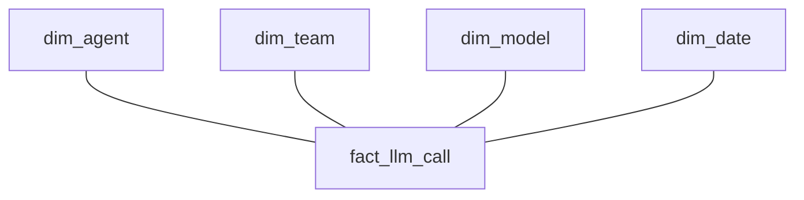

# Chapter 9 — Analytical Data Modeling

This page records study of grain, facts, dimensions, and metrics. The AI platform schema is a hypothetical design. It contains no real user or company data and does not claim implementation experience.

**Analytical data modeling** defines what rows mean and how they relate so a question can be answered correctly. Before adding a receipt total, decide whether one row means one item or one whole order. Sections 9.1–9.8 move from this row unit, or grain, to facts, dimensions, and metrics.

<!-- SOURCE CORE START -->

## 9.1 Grain

Grain states what one table row means. One order and one order item have different grains, so write down which rows a total counts before building it.

> **What one row in a table means.**

Examples:

```text
fact_order
→ 1 row = 1 order

fact_order_item
→ 1 row = 1 order item

fact_llm_call
→ 1 row = 1 LLM call
```

Joining one order to several item rows without checking grain can count the order amount several times.

Modeling order:

```text
1. Grain
2. Fact
3. Dimension
4. Metric
```

---

## 9.2 Fact Tables

A fact table records a measurable event or state at a defined time. One payment and a daily inventory balance can both be facts, but their grains and update patterns differ.

> **Events or measurements.**

### Event Fact

Examples: clicks and API calls.

### Transaction Fact

Examples: orders and payments.

### Periodic Snapshot Fact

State at regular intervals, such as daily inventory or daily balances.

### Accumulating Snapshot Fact

The progress of one process through its stages.

Example:

```text
order_created_at
paid_at
shipped_at
delivered_at
```

---

## 9.3 Dimension Tables

A dimension describes the who, what, or when around a fact. If a customer's region changes, keys and history rules determine which region past orders belong to.

> **Attributes that describe a fact.**

Examples:

```text
dim_customer
dim_product
dim_model
dim_team
```

### Natural Key

An identifier from the source system.

### Surrogate Key

A separate key created in the analytical system.

It helps distinguish SCD Type 2 versions.

---

## 9.4 Star Schema

A star schema connects a central fact with surrounding dimensions. It makes totals by date or product easier to understand, but each join still needs correct keys and grain.

```text
             dim_agent
                 |
dim_team — fact_llm_call — dim_model
                 |
              dim_date
```

Benefits:

- Easy to understand.
- Easy to query from BI tools.
- Clear roles for tables.

---

## 9.5 SCD

SCD (Slowly Changing Dimension) handles descriptive values that change over time. Think of an address book: you can keep only a new address or also retain the old address with its dates. Choose Type 1 or Type 2 based on whether you need only the current customer tier or also the tier at an order's time.

### Type 1

Overwrite.

Only the current value matters.

### Type 2

Keep past states.

Example:

```text
customer_sk | customer_id | region | valid_from | valid_to
```

This supports analysis of past states.

---

## 9.6 Denormalization

Denormalization stores some information together to simplify reads. It can reduce joins, but mixing amounts from different grains can count the same value more than once.

Repeatedly stored values must be kept consistent when they change.

OLTP:

```text
Focus on normalization
```

OLAP:

```text
Some denormalization for query convenience and performance
```

Putting too much information in one table also creates problems.

---

## 9.7 AI Platform Modeling

In an AI platform, one agent execution and one LLM call are different row units. If an execution has several calls, a join can repeat execution cost when totals are calculated.

User events also have a different grain from executions and calls. Joining across these grains can inflate costs or counts.

### fact_agent_execution

```text
1 row = 1 agent execution
```

Example fields:

- execution_id
- agent_id
- user_id
- team_id
- started_at
- completed_at
- status
- total_latency
- total_cost

### fact_llm_call

```text
1 row = 1 LLM call
```

Example fields:

- llm_call_id
- execution_id
- model_id
- input_tokens
- output_tokens
- latency
- cost

### fact_user_event

```text
1 row = 1 user event
```

### dim_agent

Describes the agent.

### dim_model

Describes the model.

### dim_team

Describes the organization.

Several facts can share the same dimensions as conformed dimensions.

Remember:

```text
Agent Execution
≠ LLM Call
≠ User Event
```

---

## 9.8 Metrics Modeling

A metric needs a calculation rule and scope, not just a name. For an error rate, match the period, population, and exclusions for failed and total counts so dashboards use the same meaning.

Purpose:

> **Manage KPI definitions consistently.**

Example:

```text
agent_execution_error_rate
=
failed execution count / total execution count
```

### Base Metric

- execution_count
- token_count
- cost

### Derived Metric

- error_rate
- cost_per_execution

### Semantic Layer

A semantic layer defines metric meaning and rules, such as numerators, denominators, filters, and periods, so tools can calculate them consistently.

Examples:

```text
DAU
Total Cost
Error Rate
Average Latency
```

Dashboards, analysts, and AI agents can use the same definitions.

---

<!-- SOURCE CORE END -->

## Chapter takeaways

State row meaning and calculation rules before building facts or metrics. Use a small example to check that joins and history versions preserve totals.

## LLM in Practice: review duplicated costs

**Prompt:**

=== "English"

    ```text {.prompt}
    execution cost grows with the number of calls. Use each table's grain, keys, relationship cardinality, join SQL, a small synthetic sample, and metric definitions.
    Review this cost query using the stated grain of each table.
    Show row counts and duplicated measures after each join.
    Separate observed facts from hypotheses and missing information.
    Propose a minimal correction and a small example that checks the total.
    Review the material; do not apply changes.
    ```

=== "한국어"

    ```text {.prompt}
    실행 비용이 호출 수에 비례해 커진다. 함께 볼 자료는 각 table의 grain, key, 관계 cardinality, join SQL, 소규모 가상 sample, metric 정의다.
    각 table에 명시된 grain을 사용해 이 비용 query를 검토해 주세요.
    각 join 이후 행 수와 중복되는 measure를 보여 주세요.
    관찰한 사실·가설·부족한 정보를 구분해 주세요.
    최소 수정안과 합계를 확인하는 작은 예시를 제안해 주세요.
    자료를 검토하되 실제 변경은 실행하지 마.
    ```

**Key point:** 

The review should identify where a join repeats measures and provides a validation example. The LLM may hide symptoms with `DISTINCT` or combine costs at different grains. Compare totals at the original grain with totals after joins. Include multiple calls, zero calls, and SCD version boundaries. This page does not record an actual query run.

[dbt](dbt.md) · [Trino](trino.md) · [Handbook home](../index.md)

[Six related practical prompts](../prompts/analytical-modeling.md)

## Appendix: existing application notes

### Grain and double counting

Joining one order to several items repeats its order amount. Summing that amount again can overcount. Agree on the business meaning of a row before choosing physical columns. [Kimball: Grain](https://www.kimballgroup.com/data-warehouse-business-intelligence-resources/kimball-techniques/dimensional-modeling-techniques/grain/)

The event/transaction distinction explains business events. It does not mean that every modeling method treats them as separate, exclusive fact types.

### SCD and denormalization

Type 2 keeps old rows and adds new versions. Join to the version valid at the analysis time. Overlapping validity periods for one natural key can multiply rows. Define the meaning of the end boundary.

OLTP often uses normalization to manage consistent changes.

Mixing grains and update schedules during denormalization can cause repeated values and wrong totals. Compare query convenience with history and maintenance costs.

### Shared dimensions and AI platform costs

One agent execution can include several LLM calls. When joining execution costs to calls, check whether the execution row repeats once per call before summing.

Conformed dimensions need consistent meanings and key rules. Define `fact_user_event` fields separately for the business event schema. Names such as `user_id` are schema examples and contain no real personal identifiers.

### Metric calculation conditions

Use the same period, filters, and population for the numerator and denominator. Define the result when the denominator is zero. Matching names do not make metrics equivalent if their grain or exclusions differ.

### Existing conceptual diagram


