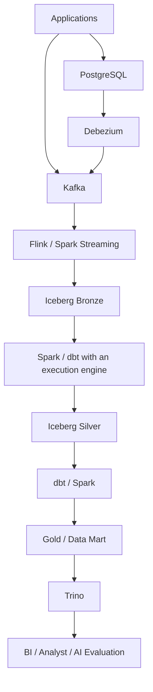
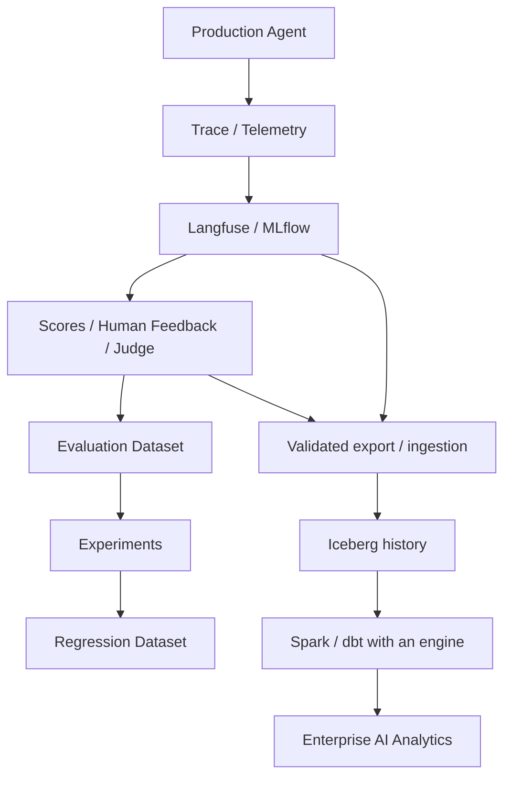

# Chapter 21 — Final End-to-End Data Platform Architecture

This page follows the outline and technical content of Chapter 21, with prose rewritten for beginners. Examples and diagrams describe studied concepts, not completed implementation, production recovery, or tests.

<!-- SOURCE CORE START -->

This is the final integration of the entire curriculum.

---

## 21.1 Core Architecture

This diagram follows application events and PostgreSQL changes through ingestion, processing, storage, and use. In a real design, PostgreSQL changes join through Debezium and Kafka; choose components for the needed delay and recovery behavior.

```text
                    Applications
                         │
              ┌──────────┴──────────┐
              │                     │
         Event Data             Operational Data
              │                     │
            Kafka              PostgreSQL
              │                     │
              │                  Debezium
              │                     │
              └──────────┬──────────┘
                         │
                  Stream Processing
                   Flink / Spark
                         │
                         ▼
                  Bronze Iceberg
                         │
                         ▼
                       Spark
                         │
                         ▼
                  Silver Iceberg
                         │
                    dbt / Spark
                         │
                         ▼
                     Gold / Mart
                         │
               ┌─────────┼──────────┐
               │         │          │
             Trino       BI      AI Evaluation
```

In this example, application events go to Kafka. PostgreSQL changes reach Kafka through Debezium. Flink or Spark Streaming writes Bronze data. Spark and dbt transformations build Silver and Gold, which Trino queries. dbt SQL runs on a connected execution engine.



The source's simpler diagram emphasizes Spark from Bronze to Silver and dbt from Silver to Gold/Data Mart. This diagram shows tool combinations within the same learning architecture. Connections require compatible connectors, catalogs, and execution engines. No end-to-end integration was tested for this material.

Role definitions are in [21.2–21.18](#212-why-kafka-exists), the [final mental model](#final-mental-model), and [source Appendix A](#appendix-a-supplementary-clarifications). Separate storage, file format, table format, compute, query, SQL model management, and orchestration.

Use these pages for conditions and evidence:

- Storage and processing: [foundations](foundations.md), [Iceberg](lakehouse-iceberg.md), [Spark](spark.md), [Flink](flink.md), [CDC](cdc-debezium.md), [dbt](dbt.md), [Trino](trino.md), and [orchestration](orchestration.md).
- Trust and policy: [quality](data-quality.md), [observability](data-observability.md), [lineage, metadata, and catalogs](lineage-metadata.md), and [governance](governance.md).
- AI execution and analytics: [AI-ready data](ai-ready-data.md), [evaluation](ai-evaluation.md), and [analytical modeling](analytical-modeling.md).

Quality rules can feed observability, but a successful pipeline does not prove correct data. The split between Langfuse and durable analytical assets is a learning design, not a product adoption decision.


---

## 21.2 Why Kafka Exists

Kafka is an **event log**, not an analytical database. Use it when several consumers need the same events at their own pace or must replay them within retention.

Role:

```text
Durable Event Transport
+
Replayable Event Log
+
Decoupling Producers/Consumers
```

Use when:

- multiple consumers need events,
- replay is valuable,
- asynchronous processing is required,
- event-driven architecture matters.

Add Kafka for real multi-consumer or replay needs. Adding it only because other platforms use it creates broker, retention, and recovery work.

At low scale:

```text
Application
 ↓
Database / Direct Batch Export
```

may be enough.

---

## 21.3 Why Flink Exists

Flink processes a continuing stream while keeping **state**. Use it, for example, to update a five-minute order total as events arrive.

```text
Stateful Real-Time Stream Processing
```

Use when:

- low latency matters,
- Event Time is important,
- Watermarks are needed,
- large stateful streaming exists,
- complex windows/sessions are required.

If latency requirements are relaxed:

```text
Kafka
 ↓
Spark Structured Streaming
 ↓
Iceberg
```

may be simpler.

---

## 21.4 Why Bronze Exists

Bronze stores data close to its source form. If a transformation rule is wrong, this saved input gives the team a place to restart.

Purpose:

```text
Replay
Audit
Debug
Reprocessing
New transformation
Historical source
```

Without durable raw history, transformation bugs can be harder to recover from.

---

## 21.5 Why Iceberg Exists

Object storage keeps files, but does not itself provide a table's current file list or consistent changes. Iceberg adds snapshots and metadata so engines can use the files as a table.

Iceberg adds the table abstraction:

```text
Schema
Snapshot
Metadata
Partition evolution
Atomic commits
Time travel
Update/Delete/Merge support
```

It allows multiple engines to work with a shared analytical table.

---

## 21.6 Why Spark Exists

Spark distributes work across machines for large data sets. Use it for large cleanup, joins, or recomputation that would take too long on one machine.

Use for:

```text
large ETL
large joins
aggregation
backfill
compaction
ML datasets
Silver/Gold transformations
```

It is compute, not storage.

---

## 21.7 Why dbt Exists

dbt helps version, order, and test SQL transformations. For example, it can turn Silver orders into Gold revenue metrics.

Use for:

```text
staging
intermediate
marts
tests
documentation
lineage
metric-oriented modeling
```

Spark and dbt are complementary.

```text
Spark
→ heavy processing

dbt
→ SQL transformation management
```

---

## 21.8 Why Gold / Mart Exists

Gold or Mart is a data layer ready for business questions. It can turn raw orders into a table of monthly revenue by product.

Examples:

```text
fact_agent_execution
fact_llm_call
dim_model
dim_team
mart_daily_ai_usage
```

BI users should not need to understand raw event internals.

---

## 21.9 Why Trino / SQL Warehouse Exists

Trino or a SQL Warehouse runs interactive SQL against stored tables. Analysts and BI dashboards need it to ask repeated questions.

```text
Iceberg Gold
 ↓
Trino
 ↓
Dashboard / Analyst
```

In managed platforms:

```text
Databricks SQL Warehouse
Snowflake Virtual Warehouse
```

can fill this role.

---

## 21.10 Why Airflow / Lakeflow Exists

Airflow or Lakeflow **orchestrates** jobs: it schedules them, orders dependencies, and handles retries. Use it when one pipeline step must finish before another starts.

Need:

```text
schedule
dependencies
retries
backfills
failure handling
parameters
alerts
```

Use:

```text
Airflow
→ cross-platform

Lakeflow Jobs
→ Databricks-centric
```

---

## 21.11 Why Data Quality Exists

**Data quality** checks whether values and structure meet expected rules. For example, catch missing order IDs or an incorrect revenue total before people use the result.

> **Can we trust the data?**

Checks include:

```text
Completeness
Uniqueness
Validity
Consistency
Freshness
Accuracy
Volume
```

Use quarantine for invalid data rather than silently dropping it.

Quality checks completeness, uniqueness, validity, consistency, freshness, accuracy, and volume. Quarantine invalid data with reasons and a reprocessing path instead of silently dropping it. Observability covers freshness, volume, schema, distribution, pipeline health, and data health. **Healthy execution and correct data are different.**

A catalog helps answer which tables exist, what columns mean, who owns them, and whether they are fresh and trustworthy. Lineage explains origins, destinations, and change impact. It supports root-cause analysis, debugging, governance, and sensitive-data tracking.

Governance covers ownership, access, sensitivity, masking, retention and deletion, and access history. Its controls include ownership, classification, retention, deletion, masking, row/column access, audit, and data contracts. AI-ready data combines trust, freshness, versioning, discovery, governance, and provenance. It does not mean giving AI uncontrolled access to enterprise data.


---

## 21.12 Why Data Observability Exists

**Data observability** shows whether data is healthy now and where a problem began. Watch delays, missing data, and changing distributions as well as job success.

> **Is the data healthy right now, and where is it becoming unhealthy?**

Observe:

```text
Freshness
Volume
Schema
Distribution
Pipeline Health
Data Health
```

Important:

```text
Pipeline Healthy
≠
Data Healthy
```

---

## 21.13 Why Metadata / Catalog Exists

**Metadata** describes data; a **catalog** helps people find those descriptions. As tables grow, teams need to locate owners, meaning, and current status.

```text
What tables exist?
What does this column mean?
Who owns it?
Is it fresh?
Is it trustworthy?
```

Catalog unifies discovery and context.

---

## 21.14 Why Lineage Exists

**Lineage** links an input to the jobs and results it produces. Use it to find which metrics might change when a source column changes.

```text
Where did this data come from?
Where does it go?
What breaks if I change it?
```

Useful for:

- root cause,
- impact analysis,
- governance,
- debugging,
- sensitive data tracking.

---

## 21.15 Why Governance Exists

**Governance** sets and applies rules for access, classification, and responsibility. It matters when deciding who may view a sensitive column.

```text
Who owns it?
Who can access it?
Is it sensitive?
Should it be masked?
How long should it be retained?
Who accessed it?
```

Capabilities:

```text
Ownership
Classification
Retention
Deletion
Masking
Row/Column Access
Audit
Data Contracts
```

---

## 21.16 Why AI-Ready Data Exists

**AI-ready data** has the quality, context, permissions, and versions needed for AI work. Connecting a file to a model alone does not make results reproducible or easy to evaluate.

```text
Trust
Freshness
Versioning
Discovery
Governance
Provenance
```

AI should not consume unmanaged enterprise data blindly.

---

## 21.17 AI Evaluation Architecture

An AI evaluation architecture connects production questions, answers, and feedback with evaluation data. Use it to compare quality after a model or prompt change.

```text
Production Agent
      ↓
Trace / Telemetry
      ↓
Langfuse / MLflow
      ↓
Scores / Feedback / Judge
      ↓
Evaluation Dataset
      ↓
Experiments
      ↓
Regression Dataset
```

Long-term:

```text
Telemetry / Evaluation
      ↓
Iceberg
      ↓
Spark / dbt
      ↓
Enterprise AI Analytics
```



The new source branches from Gold/marts to Trino, BI, and AI evaluation. The existing diagram routes consumers through Trino as one example; not every consumer must use Trino.

Arrows represent logical data movement. They do not promise automatic integration or equal product capabilities. See the [AI evaluation platform](ai-evaluation.md) for trace/evaluation IDs, normalization, versions, and Langfuse export/API paths. Separate long-term analytics from execution-level observability.

A result should link through `experiment_id` or `trace_id` to these versions:

```text
Agent version → Prompt version → Model version → Tool version
Retrieval config → Embedding version → Dataset version
Evaluator version → Git commit
```

The arrows show the order of a dependency list, not a required linear execution chain. Preserve the combination of data, prompt, model, agent, tools, retrieval, evaluator, and code. These links support reconstruction of conditions. They do not guarantee identical output when external data changes or models are nondeterministic.


---

## 21.18 Version Chain for Reproducibility

To explain a result again, link the model, prompt, data, and code versions used. That chain helps locate the cause of a regression.

```text
Agent Version
Prompt Version
Model Version
Tool Version
Retrieval Config
Embedding Version
Dataset Version
Evaluator Version
Git Commit
```

Concept:

```text
result
 ↓
experiment_id / trace_id
 ↓
all relevant versions
```

This is the basis of reproducibility.

---

## 21.19 Failure Behavior

A useful architecture describes failures as well as normal flow: what data remains and where processing can restart.

### Kafka Failure

Events remain durable according to configured replication/retention.

Consumers can resume/replay.

### Flink Failure

Restore:

```text
Checkpoint / Savepoint
+
Source Offset
```

### Spark Failure

Retry failed tasks/jobs.

Jobs must be idempotent.

### Iceberg Write Failure

Uncommitted files may become orphan files.

Atomic metadata commit protects table consistency.

### Airflow Failure

Resume from failed tasks rather than rebuilding everything.

### CDC Failure

Restart from offsets; snapshot/re-bootstrap when required.

### Data Quality Failure

Contain and quarantine before publishing downstream.

| Failure | Recovery decision and boundary |
|---|---|
| Kafka | Check replication, acknowledgements, retention, and available replicas. Consumers can resume or replay retained logs. Do not assume lossless recovery from every failure. |
| Flink | Check the availability and consistency of checkpoints/savepoints and source offsets before restoring state. |
| Spark | Retry failed tasks/jobs. Check job and output idempotency and writes that already succeeded. |
| Iceberg write | An atomic metadata commit protects consistent table state. Uncommitted files may be orphaned. Do not remove them without checking active writers and retention. |
| Airflow | Verify successful upstream output remains valid, then resume failed tasks. Do not default to rebuilding everything. |
| CDC | Resume from retained offset/log state; consider snapshots or re-bootstrap when required. |
| Data quality | Contain the problem and quarantine data before downstream publication; check cause, impact, and reprocessing. |

| Boundary | Guarantee and checks |
|---|---|
| Kafka | Ordering within a partition. Delivery semantics such as at-least-once and transaction features depend on producer and consumer use. |
| Flink | Checkpointed state. End-to-end exactly-once depends on source + state + sink conditions. |
| Iceberg | Snapshot-based consistent table reads and atomic commits. This does not automatically provide a business transaction across independent tables. |
| dbt / batch | Correctness depends strongly on bounded input and idempotent transformation/write rules. |

Define input, state, output, side effects, and failure boundaries before saying the whole platform is exactly-once. Use [operations and recovery](production-operations.md) and official engine documentation to check recovery positions and duplicate handling.


---

## 21.20 Consistency Model

A **consistency model** states what each stage guarantees about duplicates, gaps, and order. A guarantee from one component does not automatically cover the whole pipeline.

Examples:

```text
Kafka
→ partition ordering
→ at-least-once / transactional features depending on usage

Flink
→ checkpointed state
→ end-to-end exactly-once depends on source + state + sink

Iceberg
→ snapshot-based consistent table reads
→ atomic commits

dbt / Batch
→ correctness depends heavily on idempotent transformations
```

Never say:

> "The entire platform is exactly-once"

without defining the boundary.

---

## 21.21 Backfill Strategy

A **backfill** reprocesses a bounded range of past input. Before fixing missing dates, check saved source data and a safe way to replace results.

```text
1. Rebuild only affected partition/range
2. Use Bronze history
3. Kafka replay when within retention
4. Source re-extraction if necessary
```

Backfill requirements:

```text
parameterized time range
idempotency
resource limits
quality verification
lineage awareness
```

An example priority is **rebuild the affected partition/range → use Bronze history → replay Kafka within retention → re-extract the source if needed**. This is not a mandatory command sequence. Choose according to available source data and the failure type.

Parameterize time ranges and design idempotency, resource limits, quality checks, and lineage impact analysis together. Expect retries, replay, backfills, and rollbacks. Keep justified raw history, transformation versions, and a defined source of truth. Actual procedures also need an owner, SLO, data contract, recovery input, and publication criteria.


---

## 21.22 Scaling Model

Each component scales in a different unit. Expand the actual bottleneck, such as Kafka partitions, Flink parallelism, Spark workers, or query concurrency.

### Kafka

Scale with:

```text
partitions
brokers
consumer parallelism
```

### Flink

Scale:

```text
operator parallelism
task managers
state backend/resources
```

### Spark

Scale:

```text
executors
tasks
partitions
cluster/serverless compute
```

### Iceberg

Scale through:

```text
object storage
metadata
file layout
partitioning
compaction
```

### Trino / SQL

Scale:

```text
workers / warehouse size
concurrency
query optimization
```

More Kafka partitions will not reduce total delay if Gold transformation or SQL queries remain slow. Measure each stage again.

| Component | Scaling units | Main costs |
|---|---|---|
| Kafka | Partitions, brokers, consumer parallelism | Brokers, storage, network |
| Flink | Operator parallelism, TaskManagers, state backend/resources | Always-on stream compute and state |
| Spark | Executors, tasks, partitions, cluster/serverless compute | Batch compute |
| Iceberg | Object storage, metadata, file layout, partitioning, compaction | Object storage and maintenance |
| Trino / SQL | Workers/warehouse size, concurrency, query optimization | Query compute |
| BI / AI | Concurrent users/workloads, inference and search paths | BI concurrency; AI tokens, inference, search |

Scaling one component does not remove another component's bottleneck. Before reducing unnecessary raw retention, check replay, audit, and retention requirements. Compare reduced scans, better file layout, incremental transforms, fewer duplicate materializations, and right-sized compute across the architecture. The total cost in [platform comparison](platform-comparison.md) also includes integration, upgrades, and on-call work.


---

## 21.23 Cost Model

Cost comes from event retention, streaming and batch compute, queries, metadata operations, and storage. Removing unused components is part of cost design.

```text
Kafka
→ brokers/storage/network

Flink
→ always-on stream compute/state

Spark
→ batch compute

Iceberg
→ object storage + maintenance

Trino
→ query compute

BI
→ concurrency

AI
→ tokens/inference/search
```

Lower charges in one service can be offset by copying or replay costs elsewhere. Review storage, compute, and query paths together.

Examples:

```text
Reduce unnecessary raw retention
Reduce scans
Improve file layout
Use incremental transforms
Avoid duplicate materialization
Right-size compute
```

---

## 21.24 What to Remove at Smaller Scale

A small system may not need every platform component. Without replay or very low delay requirements, start with database export and a batch job.

> **Explain what should be removed when scale is smaller.**

### Very small system

Possible:

```text
Application
 ↓
PostgreSQL
 ↓
dbt / SQL
 ↓
BI
```

No Kafka.

No Flink.

No Iceberg.

No Trino.

No separate metadata platform.

### Small analytics platform

```text
PostgreSQL / Files
 ↓
Object Storage
 ↓
Spark or managed SQL
 ↓
Warehouse / Lakehouse
 ↓
BI
```

Still possibly no Kafka/Flink.

### Medium event-driven platform

```text
Application
 ↓
Kafka
 ↓
Spark Structured Streaming
 ↓
Iceberg
 ↓
Spark/dbt
 ↓
Trino
```

Flink may still be unnecessary.

### Large real-time platform

```text
Kafka
 ↓
Flink
 ↓
Iceberg
 ↓
Spark
 ↓
Trino
```

Add:

```text
Catalog
Observability
Quality
Governance
```

when organizational/data complexity justifies them.

### Principle

> **Do not deploy technology because it exists in a reference architecture. Add it when its problem actually exists.**

Chapter 21 adds role and selection criteria to the existing architecture. These are design review examples, not an adoption ADR or a running system.

| Component | Problem and role | Omission or alternative |
|---|---|---|
| Kafka | Durable event transport, replay within retention, and producer/consumer separation. Useful when several consumers independently read events and process them asynchronously. It is not the analytical database. | A small system may only need application → database or direct batch export. |
| Flink | Low latency, event time, watermarks, large state, and complex windows or sessions in stateful streams. | With relaxed latency needs, Kafka → Spark Structured Streaming → Iceberg may be a simpler candidate. |
| Bronze | Keeps history close to source form for replay, audit, debugging, reprocessing, new transformations, and historical source access. | Define retention, access, and deletion rules together. Without raw history, transformation errors can be harder to recover from. |
| Iceberg | Adds schema, snapshots, metadata, partition evolution, atomic commits, time travel, and support for updates/deletes/merges above object-storage files. | Check engine, catalog, and format-version compatibility for multi-engine reads, writes, and row changes. |
| Spark | Large ETL, joins, aggregation, backfills, compaction, ML datasets, and Silver/Gold transformations. | It is compute, not storage. A smaller SQL runtime may be enough for small workloads. |
| dbt | Manages staging, intermediate models, marts, tests, documentation, lineage, and metric-oriented SQL models. | Complements Spark's heavy processing. A connected engine executes the SQL. |
| Gold / marts | Makes business data usable without exposing raw event internals. | Examples: `fact_agent_execution`, `fact_llm_call`, `dim_model`, `dim_team`, `mart_daily_ai_usage`. Define grain and business meaning first. |
| Trino / SQL warehouse | Interactive SQL, such as Iceberg Gold → Trino → dashboard/analyst. | Databricks SQL Warehouse or Snowflake Virtual Warehouse can fill this role in a managed platform. |
| Airflow / Lakeflow Jobs | Connects schedules, dependencies, retries, backfills, failure handling, parameters, and alerts. | Consider Airflow for cross-platform work and Lakeflow Jobs for Databricks-centered work. |

| Example scale and need | Possible architecture | Omission candidates |
|---|---|---|
| Very small system | Application → PostgreSQL → dbt/SQL → BI | Kafka, Flink, Iceberg, Trino, separate metadata platform |
| Small analytics platform | PostgreSQL/files → object storage → Spark or managed SQL → warehouse/lakehouse → BI | Kafka and Flink may still be unnecessary |
| Medium event-driven platform | Application → Kafka → Spark Structured Streaming → Iceberg → Spark/dbt → Trino | Flink if stateful low-latency processing is not required |
| Large real-time platform | Kafka → Flink → Iceberg → Spark → Trino | Add catalog, observability, quality, and governance tools as organizational and data complexity justify them |

Removing a separate tool does not remove necessary quality, access-policy, or recovery responsibilities. Start with a real problem, not the presence of a component in a reference architecture.


---

## 21.25 What Changes if Databricks Is Adopted

Databricks can combine some processing, SQL, catalog, and job management in managed services. Check separately whether it replaces any existing Kafka or external system. The following is an example of self-managed components:

```text
Spark
Trino
Airflow
Catalog
Lineage
MLflow
Vector DB
```

may partially collapse into:

```text
Databricks Runtime
SQL Warehouse
Lakeflow
Unity Catalog
MLflow
AI Search
```

Possible remaining components:

```text
Kafka
Flink
External dbt
Cross-platform Airflow
Special-purpose stores
```

Architecture becomes simpler operationally.

Trade-off:

```text
less platform engineering
+
faster integration

vs

more vendor dependency
+
platform cost
```

---

## 21.26 What Changes if Snowflake Is Adopted

Snowflake can manage parts of SQL compute, ingestion, transformation, and governance together. Streaming or external-source needs may still need separate design.

```text
Warehouse
SQL compute
Transformation
Dynamic Tables
Governance
Iceberg access
AI services
```

may move into Snowflake.

Possible remaining components:

```text
Kafka
Flink
external Spark
Airflow
special-purpose operational systems
```

Snowflake is especially natural when the organization is SQL/analytics-centered.

---

## 21.27 Open Lakehouse Final Architecture

An open lakehouse combines object storage and Iceberg with chosen processing and query tools. It gives choice while leaving the team responsible for the connections.

```text
Applications
    ↓
Kafka
    ↓
Flink
    ↓
Iceberg on S3
    ↓
Spark
    ↓
dbt
    ↓
Trino
    ↓
BI
```

Surrounding components:

```text
Airflow
→ orchestration

OpenLineage
→ lineage event standard

DataHub / OpenMetadata
→ catalog

Soda / Great Expectations
→ quality

Prometheus / Grafana
→ system observability

Data observability layer
→ freshness / volume / drift

MLflow / Langfuse
→ AI lifecycle
```

Strength:

```text
flexibility
portability
control
```

Weakness:

```text
integration burden
operations
upgrades
security integration
on-call complexity
```

An open-oriented example is **Applications → Kafka → Flink → Iceberg on S3 → Spark → dbt → Trino → BI**. The dbt step executes SQL through a compatible engine.

| Supporting role | Example tools |
|---|---|
| Orchestration | Airflow |
| Lineage event standard | OpenLineage |
| Catalog | DataHub / OpenMetadata |
| Quality | Soda / Great Expectations |
| System observability | Prometheus / Grafana |
| Data observability | A freshness, volume, and drift layer |
| AI lifecycle | MLflow / Langfuse |

Strengths are flexibility, portability, and control. Costs include integration, operations, upgrades, security integration, and on-call complexity. An open format does not by itself make SQL, catalogs, IAM, and operations portable.

A Databricks-centered candidate is:

```text
Sources → Kafka / Lakeflow Connect
→ Lakeflow Pipelines / Spark Streaming
→ Delta / Iceberg
→ Databricks Runtime / dbt → Gold
→ SQL Warehouse → BI

Unity Catalog: governance / lineage
Lakeflow Jobs: orchestration
MLflow: ML / AI lifecycle
AI Search: retrieval
Model Serving: inference
```

Some self-managed Spark, Trino, Airflow, catalog, lineage, MLflow, and vector-store responsibilities may combine into Runtime, SQL Warehouse, Lakeflow, Unity Catalog, MLflow, and AI Search. Kafka, Flink, external dbt, cross-platform Airflow, and special-purpose stores may remain. A matching feature name does not prove full replacement. Compare less platform engineering and faster integration with vendor dependency and platform cost.

A Snowflake-centered candidate is:

```text
Sources → Snowpipe / Streaming / external ingestion
→ Snowflake / Iceberg
→ Dynamic Tables / SQL transformation → Data marts
→ Virtual Warehouses → BI

Horizon: governance
Cortex / Search / Agents: AI
```

This can combine warehouse, SQL compute, transformation, Dynamic Tables, governance, Iceberg access, and AI services. Kafka, Flink, external Spark, Airflow, and special-purpose operational systems may remain. Treat its fit for SQL/analytics-centered organizations as a learning heuristic, not proof that it always performs better or costs less.

Check cloud, region, edition, runtime, table mode, and connector conditions. [Databricks](databricks.md) and [Snowflake](snowflake.md) document capabilities, limits, and official sources. Managed diagrams also describe untested integration candidates.


---

## 21.28 Managed Platform Final Architecture

A managed platform combines functions in one service to reduce operations work. Check data movement, access, cost, and external-engine support against real requirements. The following example centers on Databricks:

```text
Sources
 ↓
Kafka / Lakeflow Connect
 ↓
Lakeflow Pipelines / Spark Streaming
 ↓
Delta / Iceberg
 ↓
Databricks Runtime / dbt
 ↓
Gold
 ↓
SQL Warehouse
 ↓
BI

Unity Catalog
→ governance + lineage

Lakeflow Jobs
→ orchestration

MLflow
→ ML/AI lifecycle

AI Search
→ retrieval

Model Serving
→ inference
```

Snowflake-centered example:

```text
Sources
 ↓
Snowpipe / Streaming / External ingestion
 ↓
Snowflake / Iceberg
 ↓
Dynamic Tables / SQL Transform
 ↓
Data Marts
 ↓
Virtual Warehouses
 ↓
BI

Horizon
→ governance

Cortex / Search / Agents
→ AI
```

---

## 21.29 Final Architecture Decision Checklist

Start the final decision with requirements, not a list of tools. Set delay, recovery, correctness, and cost goals, then ask what each component contributes.

### Kafka

```text
Do we need replayable event transport?
Do multiple consumers need the same event?
```

### Flink

```text
Do we really need stateful low-latency streaming?
```

### Iceberg

```text
Do we need open object-storage analytical tables,
snapshots, multi-engine access, and large history?
```

### Spark

```text
Do we have large-scale transformation/backfill workloads?
```

### dbt

```text
Do we need SQL transformation governance and reusable models?
```

### Trino

```text
Do we need interactive SQL over open lakehouse data?
```

### Airflow

```text
Do workflows span multiple systems and need orchestration?
```

### Catalog / Lineage

```text
Has the organization reached a point where users cannot
reliably find, understand, or assess impact on data?
```

### Data Quality / Observability

```text
Would wrong or stale data create meaningful business damage?
```

### Managed Platform

```text
Is reducing operations/integration work worth the vendor cost/dependency?
```

Use the [21.29 checklist](#2129-final-architecture-decision-checklist) and [seven engineering principles](#final-engineering-principles). Attach an actual requirement, owner, evidence, and failure impact to each keep/remove decision. Source data, reprocessing, quality, and access responsibilities remain at small scale.


---

<!-- SOURCE CORE END -->

<!-- SOURCE FINAL START -->

# Final Mental Model

This diagram follows raw inputs through processing into analytics and AI. In a real design, PostgreSQL changes join the event path through Debezium and Kafka:

```text
Sources
│
├─ Operational DB
│     ↓
│   CDC
│
└─ Events
      ↓
    Kafka
      ↓
Streaming Processing
      ↓
Raw / Bronze
      ↓
Lakehouse Table
      ↓
Batch Transformation
      ↓
Silver
      ↓
Modeling / dbt
      ↓
Gold / Marts
      ↓
SQL Serving
      ↓
BI / Analytics / AI
```

The following functions span the whole path. For example, quality checks matter before Gold is published as well as during Silver processing:

```text
Orchestration
→ when and in what order

Quality
→ can we trust the data

Observability
→ is the data healthy now

Metadata / Catalog
→ what data exists

Lineage
→ where did it come from and where does it go

Governance
→ who can use it and how

AI Evaluation
→ how good are model/agent outputs

Versioning
→ what exact system produced this result

Cost
→ what resources are consumed

Recovery
→ how do we restore correct state after failure
```

Choose a tool by its job before choosing a product. These are the main roles of the technologies:

```text
PostgreSQL
→ operational state

Kafka
→ event log / transport

Debezium
→ database changes → event stream

Flink
→ stateful real-time processing

Spark
→ large-scale distributed processing

Parquet
→ columnar analytical file format

Iceberg
→ open lakehouse table format

dbt
→ SQL transformation management

Trino
→ interactive distributed SQL

Airflow / Lakeflow Jobs
→ orchestration

Data Quality tools
→ validation

Data Observability
→ freshness / volume / drift

OpenLineage
→ lineage event standard

Catalog
→ discovery / metadata

Governance
→ access / classification / audit

Langfuse / MLflow
→ AI telemetry / evaluation / experiments

Databricks / Snowflake
→ managed platforms that consolidate many of the above roles
```

---

# Final Engineering Principles

## Principle 1 — Start from the problem, not the tool

Choosing a tool before checking the problem and scale adds operating work. For example:

```text
"We should use Kafka because modern platforms use Kafka."
```

Better:

```text
"We need replayable events consumed independently by five systems."
→ Kafka may be justified.
```

---

## Principle 2 — Keep roles clear

These roles connect but do different jobs. S3 stores files, while Iceberg manages their table state:

```text
Storage
Table Format
Compute
Transformation
Query Engine
Orchestrator
Catalog
```

Example:

```text
S3
→ storage

Parquet
→ file format

Iceberg
→ table format

Spark
→ compute

dbt
→ transformation management

Trino
→ query engine

Airflow
→ orchestration
```

---

## Principle 3 — Design for reprocessing

In production, teams need to rerun failed work, replay saved inputs, and undo bad results:

```text
retry
replay
backfill
rollback
```

Therefore:

- keep raw history when justified,
- make tasks idempotent,
- parameterize time ranges,
- version transformations,
- define source of truth.

---

## Principle 4 — Data correctness is separate from system health

```text
Job Success
≠
Correct Data
```

Measure job success and data correctness separately. A successful job can still publish wrong revenue.

---

## Principle 5 — Version AI systems as systems

An AI output also depends on data, prompts, tools, and retrieved content. Version them together to explain regressions.

Version:

```text
Data
Prompt
Model
Agent
Tools
Retrieval
Evaluator
Code
```

---

## Principle 6 — Managed platforms trade control for integration

Open:

```text
more control
more portability
more platform work
```

Managed:

```text
less integration work
faster delivery
more vendor dependency
```

Choose based on the team's operating capacity, data movement, and access needs.

---

## Principle 7 — Remove components when they are not earning their operational cost

More technologies add connections and failure points. Keep the components that solve real requirements.

A mature platform is one where:

> **Every component exists because a real requirement justifies its complexity.**

---

<!-- SOURCE FINAL END -->

## Appendix A — Supplementary Clarifications

<!-- SOURCE APPENDIX START -->

## 17.1 Overall Technology Role Map

This study diagram joins application events and database changes in Kafka before Bronze, Silver, and Gold. A different source may need a different ingestion path:

```text
Applications
   ↓
Kafka
   ↓
Flink / Spark Streaming
   ↓
Iceberg Bronze
   ↓
Spark / dbt
   ↓
Silver / Gold
   ↓
Trino
   ↓
BI / Analyst / AI Evaluation
```

PostgreSQL Operational Data:

```text
PostgreSQL
   ↓
Debezium
   ↓
Kafka
```

Supporting systems:

```text
Airflow
→ Orchestration

Data Quality
→ Trust

Data Observability
→ Freshness / Volume / Drift

OpenLineage
→ Lineage Standard

Catalog
→ Discovery / Metadata

Governance
→ Access / Classification / Audit

Langfuse
→ AI Telemetry / Evaluation
```

---

## 17.2 Storage / Table / Compute / Query / Transformation Boundaries

```text
S3
→ Object Storage

Parquet
→ Columnar File Format

Iceberg
→ Table Format / Metadata / Snapshot

Spark
→ Large-scale Compute

Flink
→ Stateful Streaming Compute

Trino
→ Distributed SQL Query Engine

dbt
→ SQL Transformation Management

Airflow
→ Orchestration
```

Storage keeps files, a table format organizes them as a table, and compute processes them. These roles help teams avoid adding two tools for one need.

---

## 17.3 Data Quality vs Data Observability

### Data Quality

Question:

> Does the data satisfy the rules we defined?

Examples:

- not null
- unique
- accepted values
- accuracy

### Data Observability

Question:

> How is data health changing during operations, and where did problems appear?

Examples:

- freshness
- volume
- schema
- distribution
- anomaly
- alert

A quality rule might check that order IDs are present; observability tracks when that check or data freshness begins to worsen.

---

## 17.4 Metadata / Catalog / Semantic Layer Differences

### Metadata

Metadata describes data, such as its schema, owner, and last update time.

### Catalog

A catalog lets people search metadata to find the table they need.

### Business Metadata

Business metadata explains, for example, whether `revenue` means sales before or after refunds.

### Semantic Layer

A semantic layer defines metrics such as revenue and dimensions such as date so many queries use the same meaning and calculation.

### Lineage

Lineage links a source column through transformations to a dashboard measure.

### Governance

Governance sets rules for who may view sensitive columns and who owns them.

---

## 17.5 AI Observability vs General Data Platform

AI observability/evaluation tools such as Langfuse handle the following well.

- Trace
- LLM Call
- Tool Call
- Prompt
- Response
- Token
- Cost
- Latency
- Score
- Dataset
- Experiment

AI tracing tools do not cover all of these long-term storage and enterprise analytics roles:

- Enterprise Analytics
- Lakehouse Storage
- Cross-domain Join
- Data Governance
- Long-term History
- Unified Catalog

They do not replace all of these.

Suggested role separation:

```text
Langfuse
→ AI execution-level telemetry/evaluation

Data Platform
→ durable analytical data asset
```

---

<!-- SOURCE APPENDIX END -->

## A beginner's guide to the connections

Follow the architecture like a parcel route. Application events enter Kafka; changes in an operational database reach Kafka through CDC. Processing keeps the records close to their source form in Bronze, cleans and validates them in Silver, and builds ready-to-use results in Gold for query, analytics, and AI consumers. The key is that each stage has a different answer to **what it stores, what it changes, and where recovery can restart**.

If an order metric is wrong, trace back from the dashboard through the Gold calculation, Silver cleanup, and Bronze source. Lineage helps find the route. Quality checks whether data meets its rules. Observability helps locate delays and anomalies. Orchestration coordinates execution but does not guarantee correctness. A small system may not need every component; apply the removal criteria in [21.24](#2124-what-to-remove-at-smaller-scale) against actual requirements.

## Key points

- Separate storage, transformation, query, and recovery duties from sources to consumers.
- Quality, observability, lineage, and governance check and control the whole flow.
- Add components for real requirements; remove those whose operating cost exceeds their value at small scale.

## LLM in Practice

**Prompt:**

=== "English"

    ```text {.prompt}
    Adapt a reference architecture to the needs of a small team.
    First compare current component roles with actual requirements.
    List candidates to retain, remove, or combine in a managed platform, with reasons.
    Review the material; do not apply changes.
    ```

=== "한국어"

    ```text {.prompt}
    참조 구조를 작은 팀의 실제 요구에 맞춰 단순화하려 한다.
    먼저 현재 구조의 역할과 실제 요구를 대조해 주세요.
    유지·생략·managed 통합 후보를 근거와 함께 나눠 주세요.
    관측한 사실과 가정, 부족한 근거를 구분하고 전체 연결의 보장을 근거 없이 단정하지 마.
    자료를 검토하되 실제 변경은 실행하지 마.
    ```

**Key point:** It may treat managed feature names as full replacement, automatic access-policy propagation, or consistency guarantees. It may remove necessary controls at small scale.

A component decision table and validation plan that expose unowned responsibilities.

An owner compares workloads, support documentation, settings, and result, latency, and recovery evidence on the same input. This example does not authorize actual changes.

## Evidence and verification scope

[Databricks data engineering](https://docs.databricks.com/aws/en/data-engineering) and [Snowflake architecture](https://docs.snowflake.com/en/user-guide/intro-key-concepts) were checked on 2026-09-26. Linked canonical topics contain detailed product evidence. This page combines source architecture concepts and principles; connector integration, SQL, failure recovery, and performance were not executed.
