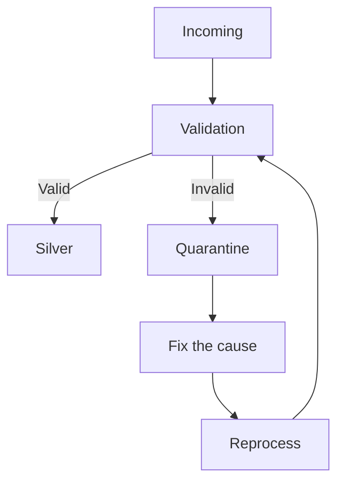

# Chapter 11 — Data Quality Engineering

This chapter covers data quality concepts and hypothetical operations. It does not claim hands-on implementation or incident response. Data quality asks, “Can we trust and use this data?” A service can respond while its data is wrong. That is still a data incident.

<!-- SOURCE CORE START -->

## 11.1 Quality Dimensions

Quality dimensions split “Can we use this data?” into separate questions. Checking a shipment means checking both its count and its contents. For `fact_llm_call`, check missing values, duplicates, valid formats, and agreement with actual billing separately. Passing one check does not rule out another error.

### Completeness

Are all required values present?

### Uniqueness

Does a value that must be unique appear only once?

### Validity

Does each value fit the agreed format and range?

### Consistency

Do values agree with related tables and records?

### Freshness

Did data arrive by the time it was needed?

### Accuracy

Do recorded values match actual events or bills?

### Volume

Is the row count close to the expected range?

AI example:

```text
fact_llm_call

Completeness
→ model_id NULL?

Uniqueness
→ Duplicate llm_call_id?

Validity
→ Negative latency?

Consistency
→ model_id exists in dim_model?

Freshness
→ Latest event within 5 minutes?

Accuracy
→ Cost agrees with billing?

Volume
→ Sharp rise or fall in call volume?
```

One healthy metric does not prove that every dimension is healthy. A valid format does not prove that a billed amount is accurate. Five-minute freshness is an example, not a default target for every dataset.


---

## 11.2 Validation Layers

Validation layers check what can be known as data moves through the platform. At ingestion, check parsing and required fields. In Silver, check duplicates and relationships. In Gold, check business metrics and aggregates. Passing an earlier layer does not remove the need for later checks.

### Ingestion Validation

- Schema
- Format
- Required fields
- Parsing

### Silver Validation

- Deduplication
- Relationships
- Business rules
- Valid values

### Gold Validation

- KPIs
- Freshness
- Aggregate consistency
- Expected volume

Focus by layer:

```text
Early
→ Format

Middle
→ Data logic

Final
→ Business results
```

---

## 11.3 Quarantine Patterns

Quarantine is a separate holding area for records that fail a rule. It supports investigation and reprocessing. Think of holding a parcel with an unclear address at a service desk until someone checks it. Silently dropping a bad order makes its absence hard to explain later. Keep the source record and error reason, while limiting access and retention for sensitive data.

Keep records that fail a rule in a separate area instead of silently dropping them.

```text
Incoming
 ↓
Validation
 ↙      ↘
Valid   Invalid
 ↓        ↓
Silver   Quarantine
```

Quarantine is not the final step. After the cause is fixed, reprocessed data must pass the same validation before entering Silver.



Keep information needed for investigation in quarantine:

- Raw payload
- Error type
- Error message
- Received time

Store these details, among others.

After fixing the cause, reprocess only the affected data.

Do not let quarantine grow without review. Track its record count and error reasons.

Raw payloads and error messages may contain sensitive information. Define storage scope and access with the [governance policy](governance.md). This page contains no real payloads.


---

## 11.4 dbt Tests

A dbt data test runs a SQL check on real table data to find rule violations such as `not_null` or `unique`. For example, check duplicate `llm_call_id` values before and after a release. Here, “static” means the rule is predefined; it does not mean inspecting code without running a data query.

Common dbt tests that check data quality:

- not_null
- unique
- relationships
- accepted_values

Strength:
- Static validation at the model/table level.

Areas that may need more checks:
- Volume anomalies
- Distribution drift
- Freshness anomalies

The source’s “static validation” means fixed rules. A dbt data test runs SQL against actual data; it is not just static code analysis. Custom SQL tests can express business rules. [dbt data tests](https://docs.getdbt.com/docs/build/data-tests)

The limits of the four basic tests do not mean dbt cannot check freshness. Source freshness is a separate feature. Statistical anomaly detection also needs historical measurements and a baseline. [dbt source freshness](https://docs.getdbt.com/docs/deploy/source-freshness)

Check these boundaries when applying each tool:

- Soda: support for the rule and connected data source.
- Great Expectations: execution environment and data connections.
- Deequ: compatibility with Spark and library versions.

Product descriptions retain the scope checked against official documentation on 2026-09-24. This edit did not recheck them, test implementations, or rank the tools. [SodaCL v3](https://docs.soda.io/soda-documentation/soda-v3/sodacl-reference/metrics-and-checks), [GX Core](https://docs.greatexpectations.io/docs/core/define_expectations/), [Deequ](https://github.com/awslabs/deequ)


---

## 11.5 Soda / Great Expectations / Deequ

Soda, Great Expectations, and Deequ can automate data quality checks. They help when many datasets need repeated checks. First define the rule and execution environment, then choose a tool. Their capabilities overlap, so a feature name alone does not establish which one is better.

Common role:

> **Tools that check data quality rules automatically.**

### Soda

Rule- and check-based validation.

### Great Expectations

Validation based on expectations.

### Deequ

Large-scale data quality checks suited to Spark environments.

These tools overlap. This study explains the role of automated quality checks rather than each tool’s implementation.

---

## 11.6 Data Quality SLOs

Keep the measured value and agreed target separate when judging data health. If the latest event is three minutes old, three minutes is the SLI; “within five minutes” could be this dataset’s SLO. The numbers below are teaching examples. Set real targets for consumer needs and a defined measurement window.

SLI:

> An actual measurement.

SLO:

> A target level.

Examples:

```text
Freshness < 5 min
Completeness > 99.9%
Duplicate Rate < 0.01%
```

Set each dataset’s SLO for how people use that data.

A live dashboard may need fresher data than a monthly report.

The SLO values in the main text are learning examples, not measured results or approved production targets.

For operational SLOs, define the clock, measurement window, denominator, and dataset scope.

Do not close recovery just because a job succeeded. Check the reprocessing scope, duplicate risk, and downstream results. [Data observability](data-observability.md) helps measure ongoing health. [Lineage](lineage-metadata.md) helps find affected paths.


---

## 11.7 Incident Handling

Judge a data incident by the result users receive, not only by job status. A batch can succeed while duplicate orders corrupt an aggregate. Stop the spread, fix the cause, reprocess the affected range, and verify the result before resuming. Each step needs evidence so recovery is clear.

Flow:

```text
Detect
 ↓
Contain
 ↓
Fix
 ↓
Reprocess
 ↓
Verify
```

### Detect

Find an SLO violation.

### Contain

Stop incorrect data from spreading downstream.

### Fix

Correct the root cause.

### Reprocess

Backfill or replay the affected data.

### Verify

Run quality checks before resuming use.

Keep this in mind:

> **Incorrect data is a data incident even when the service is available.**

---

<!-- SOURCE CORE END -->

## Chapter key points

- Each quality dimension finds a different kind of error. A successful job does not prove accurate data.
- Check data at ingestion, cleanup, and aggregation. Isolate failures, then verify the cause and the scope of reprocessing.
- Agree on targets and recovery criteria per dataset. Observability helps detect change; lineage helps find affected users and outputs.

## LLM in Practice: review quality incident checks

**Prompt:**

=== "English"

    ```text {.prompt}
    A job succeeded, but duplicates increased in a hypothetical call table.
    Review this data incident before proposing a redesign.
    Review the material; do not apply changes.
    ```

=== "한국어"

    ```text {.prompt}
    작업은 성공했으나 가상의 호출 테이블에 중복이 증가했다.
    재설계를 제안하기 전에 이 데이터 장애를 검토하세요.
    자료를 검토하되 실제 변경은 실행하지 마.
    ```

**Key point:** A review that separates cause hypotheses, evidence to check, containment options, reprocessing scope, and resume criteria. It may treat correlation between retries and duplicates as proof. It may assume the wrong deduplication key or grain. Check real key definitions, logs, reprocessing windows, before-and-after quality measurements, and downstream aggregates. LLM output is a hypothesis. It does not replace operational approval.

[Handbook home](../index.md)

[More practical prompts](../prompts/data-quality.md)
