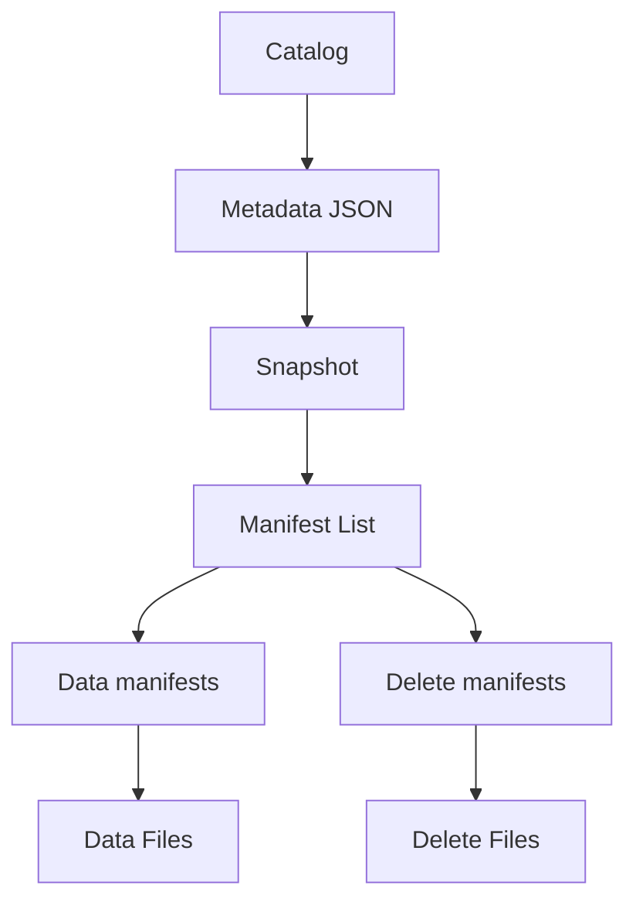

# Chapter 3 — Lakehouse / Iceberg

<!-- SOURCE CORE START -->

## 3.1 Lakehouse Architecture

A lakehouse combines the open storage of a data lake with the table management of a warehouse. Use it when you want flexible files and reliable table reads and updates.

Big picture:

```text
Object Storage
   ↓
Parquet Files
   +
Table Format
   ↓
Iceberg
   ↓
Compute
Spark / Trino / Flink
   ↓
Catalog / Governance
```

Main layers:

- Storage Layer
- Compute Layer
- Table Format
- Catalog
- Governance / Control Plane

Comparing the layers helps separate storage formats from the engines that use them.

| Layer | Role |
| --- | --- |
| Object storage | Holds persistent objects |
| File format, such as Parquet | Encodes the data within files |
| Table format, such as Iceberg | Describes a consistent table across files |
| Compute, such as Spark, Trino, or Flink | Reads, transforms, and writes data |
| Catalog | Finds tables and their metadata |
| Governance | Manages policies and accountability |

---

### Data Plane vs Control Plane

Data Plane:

- Actual Parquet files
- Actual query, read, and write operations

Control Plane:

- Metadata
- Catalog
- Access Policy
- Governance
- Table Definition

This split clarifies which work reads and writes files and which work manages table definitions and access.

The layer model describes responsibilities, not a sequence where the catalog runs after compute. The catalog helps locate metadata; engines use it to read files. The pruning list also describes cooperating layers, not one required execution order.

---

## 3.2 Iceberg Metadata Internals

Iceberg does more than store Parquet files: it manages **table metadata**. Think of metadata as an index that lists the files in the current table so multiple engines can read one consistent state.

A simplified structure:

```text
Iceberg Table
   ↓
Metadata JSON
   ↓
Snapshot
   ↓
Manifest List
   ↓
Manifest Files
   ↓
Data Files
```

A SQL query sees `prod.db.orders` as one orders table. The storage system does not hold one large file with that name. Instead, an engine follows **the registered table name → current metadata → data files** and reads them as one **logical table**.

Follow the orders example below. The paths and names are illustrative; actual layouts depend on the catalog and engine.

```text
Catalog: prod.db.orders
  → current metadata: s3://lake/orders/metadata/v2.metadata.json

s3://lake/orders/
  metadata/v1.metadata.json       previous table state
  metadata/v2.metadata.json       current table state
  metadata/snap-202-1.avro        snapshot 202 manifest list
  metadata/manifest-a.avro        data manifest
  data/orders-a.parquet           rows and columns
```

Here, the catalog points to `v2.metadata.json`. The `v1` and `v2` in these example filenames label metadata revisions, not Iceberg table format versions.

**The directory listing is not the current table’s file list.** The engine follows references from the current metadata to choose files. Older snapshots may still use older files, so a directory listing alone is not enough to decide what to delete or what the table contains.

---

### Metadata JSON

Metadata JSON describes the current schema, partition rules, and snapshots. It acts like an index that an engine checks before reading data files.

Opening `v2.metadata.json` reveals information like the example below. **A snapshot is a record inside this file’s `snapshots` array, not a separate JSON file.**

This illustrative JSON excerpt keeps only the fields needed to follow the links.

```json
{
  "current-snapshot-id": 202,
  "snapshots": [{
    "snapshot-id": 202,
    "manifest-list": "s3://lake/orders/metadata/snap-202-1.avro"
  }]
}
```

Information can include:

- Current snapshot
- Schema
- Partition Spec
- Sort Order
- Snapshot History

---

### Current Snapshot

The current snapshot points to the consistent set of files in the table now.

Read the JSON above in this order. This example uses Iceberg table format v2.

1. `current-snapshot-id` is `202`, so snapshot 202 is current.
2. Find the record whose `snapshot-id` is `202` in the `snapshots` array.
3. Follow its `manifest-list` path to `snap-202-1.avro`.

---

### Snapshot Log

Records the history of past snapshots.

Metadata JSON can therefore have several versions over time.

Question:

> Can Iceberg have several table metadata files?

Answer:

> Yes. Table-state changes create new metadata files. The catalog or metadata pointer identifies the current metadata.

---

### Manifest List / Manifest File

Instead of listing every data file directly, a snapshot uses intermediate metadata layers.

Concept:

```text
Snapshot
  ↓
Manifest List
  ↓
Manifest
  ↓
Data File
```

The intermediate lists organize file paths and statistics, so an engine can choose useful files without opening every file in a large table.

The `snap-202-1.avro` file found above is the **Manifest List**. It holds a **list of Manifest Files**, not the order rows. Follow a Manifest File to find the paths of the actual data files.

| Step | Example file | Contents |
| --- | --- | --- |
| Manifest List | `snap-202-1.avro` | Manifest File paths and summaries |
| Manifest File | `manifest-a.avro` | Data or delete file paths and statistics |
| Data File | `orders-a.parquet` | Actual order rows and columns used to produce query results |

**Following the fields inside each file**

In format v1–v3, both Manifest Lists and Manifest Files are **Avro binary files**. The descriptions below explain decoded records, not literal text in those files.

- **One Manifest List record** points to a Manifest File through `manifest_path`: `manifest-a.avro` in this example. It also summarizes the file size (`manifest_length`), partition spec ID (`partition_spec_id`), file counts, and partition ranges. A Manifest List is written for each snapshot.
- **One Manifest File entry** points to a data or delete file through `data_file.file_path`: `orders-a.parquet` here. It also stores the format, row count (`data_file.record_count`), size, and optional column statistics.
- An entry’s `status` distinguishes added, existing, and deleted files. For example, `status=1` (ADDED) with `snapshot_id=202` marks a file added in snapshot 202.

These separate lists and statistics help an engine choose the files it needs. Later snapshots can reuse unchanged manifests and data files.

**Version scope**

The example uses format v2; this reference structure is available in v1–v3. However, v1 also allows a snapshot to list manifest paths directly in its `manifests` array without a Manifest List.

Format v4 uses a Parquet **Root Manifest** instead of a Manifest List. The Avro chain above therefore does not describe every version. [Snapshot specification](https://iceberg.apache.org/spec/#snapshots), [Manifest List specification](https://iceberg.apache.org/spec/#manifest-lists), [Manifest field specification](https://iceberg.apache.org/spec/#manifest-schema)

**Inspecting a real table**

In Spark, use these metadata tables to inspect reference paths. Check support for your engine and Iceberg version. [Spark metadata table documentation](https://iceberg.apache.org/docs/latest/spark-queries/#metadata-tables)

- `.snapshots`: the snapshot’s `manifest_list` path
- `.manifests`: Manifest File paths
- `.entries`: individual entries inside Manifest Files

```sql
SELECT * FROM prod.db.orders.snapshots;
SELECT * FROM prod.db.orders.manifests;
SELECT * FROM prod.db.orders.entries;
```

---

### Data Files

Parquet, ORC, or Avro files that hold the actual data.

### Delete Files

Approaches such as merge-on-read can manage deletion information in separate files.

An older metadata file does not automatically describe the current table. Manifests describe data or delete files and their metadata.

This diagram follows references from the catalog to the files in a v2 table that uses separate delete files. The snapshot is a record inside Metadata JSON. Data manifests and delete manifests are separate files. Arrows show references, not a sequence of data copies.



---

## 3.3 Snapshot Semantics

A snapshot records the whole table state at a point in time. Think of an updated book index that still reuses unchanged pages instead of copying the entire book.

Important point:

> A snapshot does not make a new copy of every file.

Several snapshots can share the same data files.

```text
Snapshot 1
→ A, B, C

Snapshot 2
→ A, B, C, D
```

A, B, and C can remain shared while only D is added.

---

### Time Travel

Query an earlier snapshot.

### Rollback

Return the table to an earlier snapshot state.

### Consistent Read

A query reads from a chosen snapshot. This boundary keeps it from seeing a table that is only partly updated while a write is in progress.

### Snapshot Isolation Intuition

Even when writes happen concurrently, a query reads a consistent snapshot state rather than an intermediate state.

---

## 3.4 Atomic Commit Model

Several writers can change a table at once. With **optimistic concurrency control**, Iceberg checks for conflicts at commit time, so concurrent writes do not expose an unfinished table state.

Conceptually:

```text
Current Metadata = M1

Writer A
→ Changes based on M1

Writer B
→ Changes based on M1
```

When one writer commits first, the current metadata changes.

Before committing, the other writer checks whether the current table state has changed:

- Check for conflicts
- Retry when needed

These steps may be needed.

---

### Compare-and-Swap Intuition

Think of a commit as checking: "Is the table state I started from still the current state?"

---

### Orphan Files

If files are created but the commit fails, files not referenced by table metadata may remain.

These files can become candidates for later cleanup.

The catalog supplies the atomic commit operation. Retrying does not resolve every conflict. Check the cause of the conflict and how the catalog handles it. [Iceberg specification](https://iceberg.apache.org/spec/)

---

## 3.5 Partitioning in Iceberg

**Hidden partitioning** keeps file grouping rules out of the query. A user filters a date column, and Iceberg uses its internal transform to find the relevant groups.

Users can filter logical columns without directly handling partition columns in the query.

Example:

```sql
WHERE event_time >= ...
```

Iceberg can use its partition transforms for pruning.

---

### Partition Transforms

Common examples:

- day
- hour
- bucket
- truncate

Example:

```text
day(event_time)
bucket(32, user_id)
```

---

### Partition Evolution

Change the partition spec without rewriting every older file. New files can use the new rule while metadata tracks the older one.

Example:

```text
Before: day(event_time)
After: hour(event_time)
```

Metadata can manage old and new data even when they use different partition specs. Changing the rule alone does not rearrange existing files to match it.

---

### High Cardinality Design

For high-cardinality values such as `user_id`, consider a bucket transform instead of direct partitioning.

Exact SQL spelling for partition transforms depends on the engine.


---

## 3.6 Query Pruning

For fast Iceberg queries, **pruning** means skipping files or data ranges that cannot match the filter before reading them.

> **How little data can the query read?**

Pruning stages:

```text
Partition Pruning
   ↓
Manifest Pruning
   ↓
Data File Pruning
   ↓
Parquet Row Group Pruning
   ↓
Column Pruning
```

---

### Scan Amplification

**Scan amplification** means reading far more data than the result needs. For example, a query might scan every file to find one customer.

Good layout reduces this.

---

## 3.7 Sort Order and Clustering

File minimum and maximum statistics work best when frequently queried values stay somewhat close together. For example, grouping nearby `user_id` values can help a range query skip unrelated files.

Example:

```text
random user_id distribution
```

Compared with this:

```text
Partly sorted by user_id
```

this arrangement can improve file pruning when looking for a particular user range.

Key point:

> **Design sorting and clustering around query patterns.**

Randomly spreading user IDs across all files can leave broad, overlapping min/max ranges. Sorting can narrow those ranges and help queries for one user or a user range.


---

## 3.8 UPDATE / DELETE / MERGE

A Parquet file in object storage is hard to change one row at a time. Iceberg supports UPDATE, DELETE, and MERGE at the table level, but the right method depends on write volume and read cost.

---

### Copy-on-Write

Rewrite the data files containing changed rows.

Advantages:
- Simpler reads

Disadvantages:
- More write cost

---

### Merge-on-Read

Keep the original data files, store change or deletion information separately, and combine them when reading.

Advantages:
- Potentially faster writes

Disadvantages:
- Reads can become more complex
- Delete files need management

---

### Position Delete

The position and equality deletes below mainly describe the v2 model. Later formats include other representations, such as deletion vectors. Check support in your engine and table version. [Iceberg specification](https://iceberg.apache.org/spec/)

A position delete marks a row at a specific location in a data file; readers skip that location.

### Equality Delete

An equality delete records a key or value condition. Readers can find matching rows without knowing their positions in a file.

---

### UPDATE

Conceptually:

```text
Delete the old row
+
Insert the new row
```

This is a useful conceptual model. Recording a deletion alone does not store the new value; updates must also write new values to data files.

### MERGE

MERGE can support CDC upserts, but its cost matters on large tables.

On large tables, MERGE may scan, shuffle, and rewrite significant data. Check supported operations and physical delete representations for the table format version and engine.


---

## 3.9 Maintenance

A file-based lakehouse needs **maintenance**. Too many small files, delete files, or old snapshots can slow reads and writes or increase storage cost.

### Data File Compaction

Combine small data files into suitably sized files.

### Delete File Rewrite

Rewrite when too many delete files accumulate.

### Manifest Rewrite

Reorganize manifests when there are too many for efficient use.

### Snapshot Expiration

Remove old snapshots.

### Orphan Cleanup

Remove files that metadata no longer references.

Key point:

> **Adopting Iceberg does not remove the need for maintenance.**

A retained old snapshot can still reference a file absent from the current snapshot. Orphan cleanup needs a retention margin longer than in-flight writes and correct path matching. Early cleanup can damage data. Snapshot expiration also limits time travel and rollback. [Iceberg maintenance](https://iceberg.apache.org/docs/latest/maintenance/)

---

## 3.10 Catalogs

To open an Iceberg table, an engine must find its current metadata. A **catalog** works like a library index: it links a table name to the current metadata location.

Catalog roles:

- Register table names
- Manage the location of current metadata
- Manage namespaces

Representative catalogs:

- Hive Metastore
- AWS Glue
- REST Catalog
- JDBC Catalog
- Nessie
- Unity Catalog concepts

---

## 3.11 Catalog vs Governance

A catalog helps engines find tables. **Governance** controls their use, such as who may read sensitive columns. A product can provide both roles.

### Basic catalog role

```text
table name
→ current metadata
```

This describes table registration and discovery.

### Governance

Broader responsibilities:

- Access Policy
- Ownership
- Classification
- Audit
- Lineage
- Masking

---

### Unity Catalog and Iceberg Catalog

Question:

> Is Unity Catalog an Iceberg catalog with extra information added?

It is difficult to treat them as simply the same thing.

Conceptually:

```text
Iceberg Catalog
→ Find Iceberg tables and manage metadata pointers

Unity Catalog
→ Catalog functions + Access Control + Lineage + Governance + Management of multiple Data/AI assets
```

Unity Catalog is better understood as a much broader governance layer.

Unity Catalog governs data and AI assets, including access, lineage, and audit. Check the actual Iceberg integration in the target environment. [Databricks Unity Catalog](https://docs.databricks.com/aws/en/data-governance/unity-catalog/)

---

<!-- SOURCE CORE END -->

## A beginner's guide to the connections

Think of [3.1](#31-lakehouse-architecture) and [3.2](#32-iceberg-metadata-internals) as a library: object storage holds the books, Parquet defines their internal format, and Iceberg metadata records the current list and editions. A snapshot identifies a table state at one point in time. Pruning means skipping files a query does not need. A catalog helps find that record. Files, metadata, and catalog have different duties, so recovering one part does not prove that the whole table is healthy.

For example, changing an orders table writes new data or delete files. The [3.4](#34-atomic-commit-model) commit then publishes a new snapshot. A query engine reads the files referenced by that snapshot. This flow connects [3.6](#36-query-pruning), which reduces how much is read, with [3.9](#39-maintenance), which manages old files. Before deleting files, check retained snapshots and active writers.

## Related reading

[File and partition foundations](foundations.md), [Spark](spark.md), [Flink](flink.md).

## Key points

- Iceberg provides table metadata and commit rules for files, snapshots, and schemas; it is not the data file itself.
- Partitioning, sorting, and pruning can reduce reads, but their effect depends on data layout and query filters.
- Changes, cleanup, and recovery require checks of past references and active work as well as the current snapshot.

## LLM in practice: Commit failure analysis

**Prompt:**

=== "English"

    ```text {.prompt}
    A hypothetical concurrent-write workload shows commit conflicts and apparently unreferenced files.
    Assess the commit failures.
    Separate observations, conflict hypotheses, and missing evidence.
    Identify files that may still be referenced.
    Review the material; do not apply changes.
    ```

=== "한국어"

    ```text {.prompt}
    가상 concurrent writer 작업에서 commit 충돌과 참조되지 않는 파일이 보인다.
    Commit 실패를 분석하고 관찰·충돌 가설·누락 근거를 나눠 줘.
    아직 참조 중일 수 있는 파일을 식별해 줘.
    자료를 검토하되 실제 변경은 실행하지 마.
    ```

**Key point:** The LLM may wrongly classify a file as an orphan just because it is absent from the current snapshot. Before treating a file as a deletion candidate, check all retained snapshots and in-flight writes. Compare conflict hypotheses with the catalog’s documented behavior and actual logs.

[See six more practical prompts for this topic](../prompts/lakehouse-iceberg.md)

LLM output is a working hypothesis. Check it against official docs and actual configuration, logs, and measurements. External documents reviewed: 2026-10-18. This does not mean an implementation version was tested.
