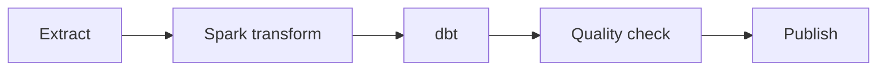

# Chapter 7 — Orchestration

This page records conceptual study of orchestration, with Airflow as the main example. It does not claim that a DAG was deployed or operated. Official documentation was checked on 2026-09-24.

**Orchestration** manages the order of data jobs and what happens when they fail. Think of a cooking plan that waits for ingredients before starting the next step. Sections 7.1–7.8 cover DAGs, retries, historical reruns, and waiting conditions.

<!-- SOURCE CORE START -->

## 7.1 DAG Fundamentals

Orchestration manages job order, schedules, and retries. An Airflow DAG shows dependencies so cleaning and checks run after input ingestion is ready.

Airflow is:

> **An orchestrator that manages the order, timing, failures, and reruns of data tasks.**

This is its role.

### DAG

A DAG is the whole workflow of tasks and dependencies. Its arrows show order without cycles.

### Task

A task is one executable step in a DAG.

### Dependency

A dependency states which task must finish before another can start.

### Schedule

A schedule sets when or how often a DAG run is attempted. It does not prove that input data is ready.

Example:

```text
Extract
 ↓
Spark Transform
 ↓
dbt
 ↓
Quality Check
 ↓
Publish
```

The arrows show task dependencies. They describe execution order, not paths for moving the data itself.



Airflow directs other systems rather than processing large datasets itself.

A dependency is a condition between tasks. A schedule defines when or how often they run. A retry does not always resolve a transient failure. Blind append can add duplicate rows during a retry.

---

## 7.2 Operators / Tasks

An operator defines how a task runs. Airflow can start Spark work or SQL, while the appropriate external engine performs the large data computation.

Operator:

> Defines how to execute a task.

Example:

- Python Operator
- SQL Operator
- Bash Operator
- Spark Job
- dbt command

Airflow's role:

```text
Airflow
→ Orchestrate

Spark
→ Compute

dbt
→ Transformation

Trino
→ Query
```

---

## 7.3 Retries

A retry runs the same task again. It may help with a temporary connection failure, but not invalid SQL; a blind append can duplicate output.

Task failures can be viewed as two types.

### Transient Failure

- Network timeout
- DB connection
- Temporary cluster issue

A retry may help when the temporary cause has cleared. Repeated failure calls for investigation.

### Permanent Failure

- SQL syntax error
- Wrong schema
- Code bug

The same failure repeats until the input or code is fixed.

### Idempotency

A retry-safe task must produce the same final result when run several times.

Bad example:

```text
Blind append
```

Methods that can help avoid duplicates when their conditions are designed correctly:

```text
Partition overwrite
MERGE
replace
```

Partition overwrite, MERGE, and replace do not guarantee idempotency by name alone. Design the input intervals, keys, and transaction boundaries correctly. Official guidance recommends avoiding duplicates on retries and reading and writing specific partitions. [Airflow best practices](https://airflow.apache.org/docs/apache-airflow/stable/best-practices.html)

Define interval boundaries and the timezone. Using `now()` or the latest data can change the result of a rerun for the same past interval. [Specific partitions and data intervals](https://airflow.apache.org/docs/apache-airflow/stable/best-practices.html)

---

## 7.4 Backfills

A backfill recomputes a defined historical interval. Use it to fill a gap or apply corrected logic, after defining the interval and how outputs will be replaced.

Backfill:

> **Recalculating past data.**

When to use it:

- Pipeline failure
- Fixing a logic bug
- Missing data
- Adding a new column
- Business logic changes

### Full Backfill

Reprocess the whole period.

### Partial / Partition Backfill

Reprocess only the required dates or partitions.

Idempotency also matters for backfills.

---

## 7.5 Sensors / Event Dependencies

A sensor waits for required input. A 2 AM schedule may start a run, but downstream work should wait if the source file is not ready.

Sensor:

> **A task that waits until a particular condition is met.**

Example:

- An S3 file arrives
- An upstream DAG completes
- Data is ready

A schedule and a dependency are different.

```text
Try to run at 02:00
+
Check that the actual data is ready
```

Both polling and event-driven approaches exist.

Check sensor and event support for the Airflow and provider versions in use. Before rerunning a failed task, check that prior upstream results are valid and belong to the same interval.

The usual `all_success` rule waits for successful upstream tasks. Other rules, such as `all_done`, may run after failures or skips. Check the publish gate's actual trigger rule. [Airflow trigger rules](https://airflow.apache.org/docs/apache-airflow/stable/core-concepts/dags.html#trigger-rules)

Including the run identifier and data interval in an alert also helps investigation.

---

## 7.6 Parameterization

A date interval parameter lets the same DAG run for an earlier day. An explicit interval such as `2026-09-24` is easier to reproduce for reads and writes than the current day at execution time.

Date and environment parameters let the same DAG run for different intervals.

Example:

```text
process_date
start_date
end_date
environment
data_interval
```

Instead of a request whose meaning changes each day:

```text
"Process today's data"
```

Use an explicit date:

```text
"Process data for 2026-09-24"
```

Receiving an explicit data interval like this helps reruns and backfills.

---

## 7.7 Failure Handling

Task status can show where to restart after failure. Before resuming downstream publication, check that earlier outputs are still valid and belong to the same data interval.

Task status can identify the restart point. First check that earlier outputs are valid for the same data interval.

```text
Extract ✅
Spark ✅
dbt ❌
Quality -
Publish -
```

After fixing the dbt problem, rerun from that task.

An upstream failure normally blocks downstream execution.

An alert needs:

- DAG
- Task
- Failure time
- Retry count
- Error

context such as these items.

---

## 7.8 Orchestrator Anti-Patterns

Large computation or data transfer inside the orchestrator can consume resources needed to manage runs. Airflow can coordinate work while Spark, Flink, SQL engines, and shared storage handle the data.

Things to avoid:

1. Run large compute jobs directly inside an Airflow worker
2. Pass large datasets through XCom
3. Overly complex dependencies between DAGs
4. Use Airflow as a streaming engine

A useful division of responsibility:

```text
Airflow
→ Orchestration

Spark
→ Batch Compute

Flink
→ Streaming

dbt
→ SQL Transformation

Iceberg
→ Storage/Table
```

Large compute jobs inside an Airflow worker tie up orchestration resources. Pass small states or paths through XCom and keep large datasets in external shared storage. [Communication between tasks](https://airflow.apache.org/docs/apache-airflow/stable/best-practices.html)

Too many dependencies between DAGs make failure impact and rerun scope hard to understand. Use a suitable streaming engine for continuous event processing. The product roles above are a design example, not a required product stack.

---

<!-- SOURCE CORE END -->

## Chapter takeaways

Define task order, retry safety, input readiness, and backfill scope together so a data interval can be rerun safely.

## LLM in Practice: review a backfill plan

**Prompt:**

=== "English"

    ```text {.prompt}
    a logic bug is fixed and seven days need reprocessing. Use the DAG dependencies, explicit date interval, source retention, output partitions, write method, failure state, and acceptance checks.
    Review this seven-day backfill plan before changing it.
    Separate known facts, assumptions, risks, and missing evidence.
    Check input intervals, retry safety, downstream gates, and validation.
    Return a bounded rerun plan and checks for duplicate or missing rows.
    Review the material; do not apply changes.
    ```

=== "한국어"

    ```text {.prompt}
    logic bug를 고친 뒤 7일치 데이터를 재처리한다. 함께 볼 자료는 DAG 의존성, 명시적 날짜 구간, source 보존 기간, 출력 partition, write 방식, 실패 상태, 검증 기준이다.
    이 7일 backfill 계획을 바꾸기 전에 먼저 검토해 주세요.
    알려진 사실·가정·위험·부족한 근거를 구분해 주세요.
    입력 구간·retry 안전성·downstream gate·검증을 확인해 주세요.
    제한된 재실행 계획과 중복·누락 행 확인 항목을 주세요.
    자료를 검토하되 실제 변경은 실행하지 마.
    ```

**Key point:** 

A useful result is a rerun scope and validation list. The LLM may assume MERGE is always safe or suggest rerunning the whole DAG. Check real keys, trigger rules, and intervals. Compare results before and after a rerun on a small partition. This page does not claim that these tests were run.

[dbt](dbt.md) · [CDC and Debezium](cdc-debezium.md) · [Handbook home](../index.md)

[Six related practical prompts](../prompts/orchestration.md)
