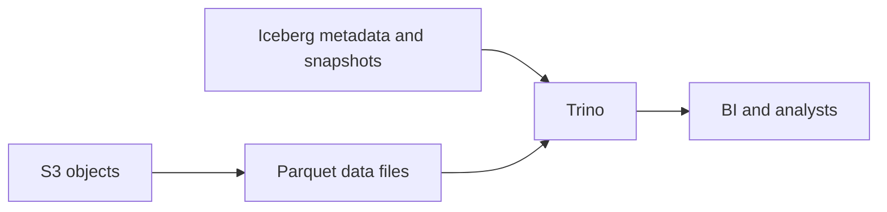

# Chapter 10 — Trino

This page records conceptual study of Trino. It does not claim verified query performance or production results. Official documentation was checked on 2026-09-24.

**Trino** is a distributed SQL query engine that can read several data sources. Imagine one desk searching inventory across warehouses while accounting for what must be moved. Sections 10.1–10.8 connect connectors, query execution, pushdown, joins, and memory.

<!-- SOURCE CORE START -->

## 10.1 Architecture

Trino is a distributed engine for SQL queries over external data. Its coordinator plans a query and workers run its parts, allowing parallel reads of large data.

Trino:

> **A distributed SQL query engine for fast queries on external data stores.**

Trino itself is not the primary storage system.

### Coordinator

- Analyze SQL.
- Build query plans.
- Manage stages and tasks.

### Worker

- Scan data.
- Join data.
- Run aggregations.

Role comparison:

```text
Trino Coordinator ≈ Spark Driver
Trino Worker ≈ Spark Executor
```

The Coordinator/Worker and Spark Driver/Executor comparison explains roles. It does not mean their execution models are identical. `SQL → Query Plan → Stage → Task → Split` is also a learning model, not a complete list of execution elements. [Trino concepts](https://trino.io/docs/current/overview/concepts.html)

A Trino catalog selects a configured connector and data source. An Iceberg catalog locates and manages table metadata. Assess remote scans, data movement, and source load for federated query performance.


---

## 10.2 Connector Model

A connector is Trino's route to a source such as Iceberg or PostgreSQL. One SQL query can join them, but remote reads and data movement still have costs.

Examples:

- Iceberg Connector
- PostgreSQL Connector
- Hive Connector

Trino table names use:

```text
catalog.schema.table
```

Examples:

```text
iceberg.analytics.fact_llm_call
postgres.public.users
```

A Trino catalog and an Iceberg catalog have different meanings.

Trino Catalog:

> Identify which connector and data source to use.

A federated query can join different systems in one SQL statement. Source reads and network movement may still make it slow.

---

## 10.3 Query Execution

Trino divides a query into stages and worker tasks. A split is a small scan unit; an exchange moves data between workers and matters when investigating slow joins.

Conceptual structure:

```text
SQL
 ↓
Query Plan
 ↓
Stage
 ↓
Task
 ↓
Split
```

### Stage

A large execution step.

### Task

Part of a stage running on a specific worker.

### Split

A small unit of scan work.

### Exchange

An exchange redistributes data between workers for operations such as joins or aggregation.

It is a similar concept to Spark shuffle.

Joins and GROUP BY operations can require many exchanges.

---

## 10.4 Pushdown

Pushdown performs a filter or aggregation near the source when supported. Like selecting only needed boxes at a warehouse, it can reduce movement, but support depends on the connector and SQL shape.

Purpose:

> **Perform supported work near the data to reduce scans and data movement.**

### Predicate Pushdown

Send `WHERE` conditions to the source.

### Projection Pushdown

Read only the required columns.

### Aggregation Pushdown

Run operations such as COUNT and SUM at the source when possible.

Iceberg partition, file, row group, and column pruning serve a similar purpose.

Pushdown support depends on the connector and query shape. A SQL filter does not guarantee pushdown. Check EXPLAIN and actual data read.

Iceberg pruning and aggregation pushdown to a remote database both aim to reduce reading and movement. They are not the same operation. [Trino pushdown](https://trino.io/docs/current/optimizer/pushdown.html)

Interpret the source’s “all workers” as workers participating in the join. Check that the small broadcast table fits each worker's memory. Skew can concentrate work and memory use on a few workers and make them finish later.


---

## 10.5 Join Strategies

A join strategy chooses whether to copy a small side or redistribute both sides by key. Both depend on size and key skew, so check the plan and measured work.

### Broadcast Join

A broadcast join copies a small table to workers participating in the join to reduce movement of the large table. Each worker needs memory for the copy.

```text
Huge Fact
+
Tiny Dimension
```

### Partitioned Join

A partitioned join redistributes both large tables by join key so matching keys meet.

This adds exchange costs.

### Data Skew

Some keys may concentrate work on a particular worker.

---

## 10.6 Memory

Trino may keep intermediate join, aggregation, or sort data in memory. Large or skewed inputs can reach memory limits and slow or fail a query. Spill moves some work to disk, but it does not solve every memory problem.

Key concepts:

- Worker Memory
- Query Memory
- Spill

Spill:

```text
Memory pressure
 ↓
Use disk
```

Where spill is supported, it may relieve some memory pressure, but disk I/O can slow the query and it cannot prevent every failure.

Spill can reduce memory pressure, but it does not solve every out-of-memory failure. Disk I/O can slow the query.

The Trino documentation checked on 2026-09-24 called spill legacy functionality. It suggested considering fault-tolerant execution with an appropriate task retry policy and exchange manager. Check applicability against the workload, connectors, and settings. This edit did not recheck official documentation or run performance experiments. [Trino spill](https://trino.io/docs/current/admin/spill.html)

The Trino/Spark comparison describes common roles. It does not define absolute feature boundaries or guarantee performance.

Iceberg pruning also depends on layout, metadata, filters, and connector behavior. [Trino Iceberg connector](https://trino.io/docs/current/connector/iceberg.html)


---

## 10.7 Trino vs Spark

Trino often serves interactive SQL while Spark often runs large transformations or recomputations. These are common roles, not fixed feature boundaries; compare latency, scale, and operations.

Common roles:

```text
Trino
→ Interactive SQL / Query Serving

Spark
→ Large-scale Processing / Transformation
```

Trino:

- BI
- Ad-hoc queries
- SQL from many concurrent users

Spark:

- ETL
- Backfills
- Large joins
- ML datasets
- Batch transforms

Using both:

```text
Spark
→ Create data

Trino
→ Query the created data
```

---

## 10.8 Trino + Iceberg

Iceberg describes a table's current files and snapshots; Parquet holds data within files. Trino uses metadata to find files and reads needed columns, so layout and connector support matter.

Structure:

```text
S3
 ↓
Parquet
 +
Iceberg Metadata
 ↓
Trino
 ↓
BI / Analyst
```

The link from S3 to Parquet shows the storage location and file format. Trino uses data files together with the Iceberg metadata that describes them to answer BI queries.



Trino uses Iceberg metadata to choose files. Where supported, it uses Parquet's column layout to read only the needed columns.

Roles:

```text
S3
→ Actual files

Parquet
→ File format

Iceberg
→ Table metadata / Snapshot

Trino
→ SQL queries
```

---

<!-- SOURCE CORE END -->

## Chapter takeaways

Trino query cost depends on source reads, worker-to-worker data movement, and memory. Check connector support, plans, and runtime measurements.

## LLM in Practice: investigate a slow federated query

**Prompt:**

=== "English"

    ```text {.prompt}
    a query joining an Iceberg fact to a PostgreSQL dimension is slow. Use anonymized SQL, EXPLAIN, actual scan and output rows and bytes, table sizes, key distributions, memory errors, and connector settings.
    Assess this federated query before redesigning it.
    Separate observations from assumptions and hypotheses.
    Check pushdown, join distribution, exchange volume, skew, and memory.
    List missing evidence and small checks that could reject each hypothesis.
    Review the material; do not apply changes.
    ```

=== "한국어"

    ```text {.prompt}
    Iceberg fact와 PostgreSQL dimension을 join한 query가 느리다. 함께 볼 자료는 익명화한 SQL, EXPLAIN, 실제 scan/output rows와 bytes, table 크기, key 분포, memory 오류, connector 설정이다.
    이 federated query를 재설계하기 전에 평가해 주세요.
    Pushdown·join distribution·exchange volume·skew·memory를 확인해 주세요.
    부족한 근거와 각 가설을 반박할 수 있는 작은 확인 작업을 나열해 주세요.
    Spill이나 broadcast가 항상 안전하다고 가정하지 말아 주세요.
    자료를 검토하되 실제 변경은 실행하지 마.
    ```

**Key point:** 

The review should link possible bottlenecks to evidence and next checks. The LLM may assume pushdown support or only suggest switching to Spark. Check the actual plan, runtime statistics, and connector documentation. Use bounded query comparisons to test each hypothesis. No performance experiment was run here.

[Analytical modeling](analytical-modeling.md) · [dbt](dbt.md) · [Handbook home](../index.md)

[Six related practical prompts](../prompts/trino.md)
