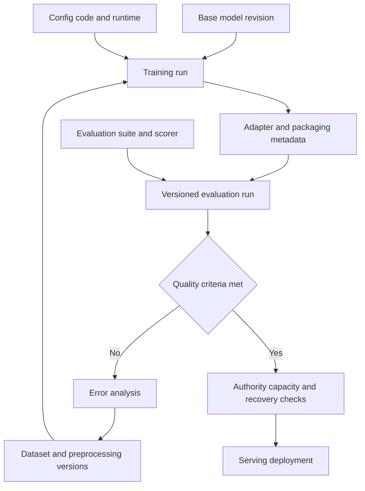

# Chapter 10. End-to-End Fine-Tuning Platform Architecture

예시 모델과 설정은 학습용이며 실제 학습·평가·배포 결과가 아니다.

<!-- SOURCE CORE START -->

## 10.1 전체 구조

학습 플랫폼은 실험실 기록장과 같다. 데이터·코드·설정·산출물·평가를 한 실행으로 묶어야 결과를 추적할 수 있고, 운영 배포는 별도 결정으로 남겨야 한다.

이번 세션의 내용을 하나로 연결하면 다음과 같다.

```text
Raw Data / Documents
↓
Data Cleaning / Curation
↓
Training Dataset
Validation Dataset
Golden Dataset
↓
Dataset Versioning
↓
Training Request
↓
Base Model 선택
+
QLoRA Config
↓
GPU Training Job
↓
LoRA Adapter
↓
S3 Artifact Storage
↓
Model Registry
↓
Golden Dataset Evaluation
↓
Quality Gate
├─ FAIL → Error Analysis → Dataset 개선 → Retraining
└─ PASS
     ↓
Model Serving
     ↓
vLLM / Serving Engine
     ↓
Production
```

**Quality Gate와 운영 전환**

원문의 `PASS → Model Serving`은 품질 기준을 통과한 후보의 다음 단계를 나타낸다. 운영 배포 권한, model 호환성, capacity, readiness나 rollback 준비를 자동으로 보장하지 않는다. 권고: 배포하려는 정확한 artifact를 평가 결과와 연결하고, 운영 담당자가 정의한 승인·용량·복구 조건을 별도로 확인한다. [AI 플랫폼 구조](../platform-infrastructure/architecture.md)와 [CI/CD·GitOps](../platform-infrastructure/cicd-gitops.md)

Golden set을 반복 비교·오류 분석에 사용하면 model 선택에 영향을 준다. 고정 회귀 suite와 독립 최종 holdout의 역할은 [모델 개발자](model-developer.md)의 8.3·8.5·8.7–8.8절처럼 구분한다.

---

## 10.2 Platform 관점의 핵심 Object

AI Fine-Tuning Platform에서 관리해야 하는 주요 Object:

```text
Base Model
Dataset
Dataset Version
Training Config
Training Run
Adapter Artifact
Evaluation Run
Evaluation Result
Model Version
Deployment
```

각 Object를 연결하는 것이 중요하다.

**추적 가능한 실행과 동일한 결과의 차이**

원문의 model·dataset·config·code·artifact 연결은 실행 추적의 출발점이다. 추가로 data preprocessing·순서, tokenizer/template, dependency·CUDA 환경, hardware, seed와 RNG state, deterministic 설정을 기록한다. PyTorch는 release·platform·device가 다르면 완전한 결과 재현을 보장하지 않는다. Seed만 같다고 artifact byte나 metric이 같아지는 것은 아니다. 허용할 metric 변동과 재실행 조건을 먼저 정의한다. [PyTorch reproducibility](https://docs.pytorch.org/docs/stable/notes/randomness.html)

---

## 10.3 재현 가능한 Training

좋은 Platform이라면 과거 Training을 다시 재현할 수 있어야 한다.

예:

```text
Training Run #1024

Base Model
→ Qwen revision X

Training Dataset
→ train-v12

Validation Dataset
→ validation-v12

Training Config
→ qlora-config-v4

Code Version
→ git commit abc123

Artifact
→ adapter-v7
```

이 정보를 이용해서 같은 조건의 Training을 다시 실행할 수 있어야 한다.



---

## 10.4 Model 교체에도 대응 가능한 구조

Base Model이 바뀌더라도 Pipeline 자체는 유지된다.

```text
Llama
↓
Training Dataset v12
↓
QLoRA
↓
Adapter A
↓
Golden Evaluation
```

새 Model:

```text
Qwen
↓
Training Dataset v12
↓
QLoRA
↓
Adapter B
↓
동일 Golden Evaluation
```

그리고 결과를 비교한다.

```text
Quality
Latency
Cost
GPU Memory
Throughput
```

이를 통해 어떤 Base Model을 Production에 사용할지 결정한다.

**Pipeline 재사용과 Model 호환성**

같은 논리 pipeline을 재사용할 수 있어도 Llama용 adapter를 Qwen에 그대로 적용한다는 뜻은 아니다. 대상 model의 module 구조·shape와 LoRA target modules, tokenizer·chat template, truncation·loss masking, serving 지원을 확인한다. 같은 원시 대화라도 model마다 필요한 control token과 표현이 다를 수 있다. [PEFT LoRA configuration](https://huggingface.co/docs/peft/package_reference/lora), [Transformers chat templates](https://huggingface.co/docs/transformers/chat_templating)

권고: 같은 golden 평가 과제·채점 기준을 유지하되 각 model에 맞는 입력 형식을 사용한다. Latency·throughput·cost 비교에는 GPU, precision, context 길이, concurrency, generation 설정과 warm/cold 상태를 기록한다. 서로 다른 serving 조건을 model 품질 차이로 단정하지 않는다.

---

<!-- SOURCE CORE END -->

## 핵심 정리

학습 실행은 데이터·코드·설정·산출물을 연결해 추적하고, 운영 배포는 별도 검증과 승인으로 다룬다.

## LLM 실무: 학습 실행의 재현성과 운영 전환 검토

**프롬프트:**

=== "한국어"

    ```text {.prompt}
    후보 adapter가 평가 기준을 통과했어. 실행 기록으로 같은 산출물을 추적할 수 있는지, 평가한 파일과 배포 후보가 같은지, 운영 전환에 필요한 근거가 있는지 검토해 줘. 점수만으로 배포를 승인하지 말고 실제 변경은 실행하지 마.
    ```

=== "English"

    ```text {.prompt}
    A candidate adapter passed evaluation. Review whether the run records trace its artifacts, whether the evaluated file matches the release candidate, and what evidence is still needed for production. Do not approve release from the score alone or apply changes.
    ```

**핵심 사항:** 누락된 재현성 기록과 artifact·evaluation 연결, 평가 독립성, 운영 전환 조건을 구분한 검토 표와 최소 수정 후보. seed만 같으면 동일 결과라고 하거나, adapter가 base model 전체라고 보거나, golden 점수 통과를 배포 승인으로 혼동할 수 있다. 실제 실행 기록·환경·checksum과 평가 입력·출력을 대조한다. 재실행은 정의한 허용 오차로 비교하고 운영 전환은 권한 있는 절차와 격리 시험으로 확인한다. 이 예시는 실제 학습·모델 응답·품질 개선을 측정한 기록이 아니다.
