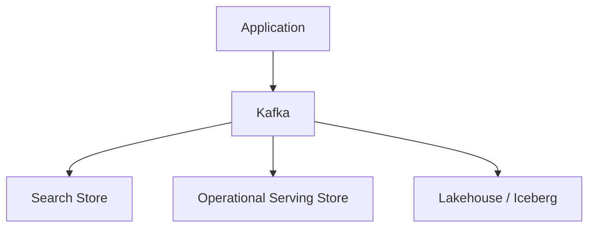

# Chapter 2 — Event Data Architecture

Kafka Broker, ISR, Replica 운영 상세는 범위 밖이다. 여기서는 데이터 엔지니어링 관점의 이벤트 의미를 다룬다.

**이벤트(event)**는 “주문이 생성됐다”처럼 이미 일어난 일을 기록한 메시지다. 택배 송장에 고유 번호와 시각이 필요한 것처럼 이벤트에도 ID와 시간 기준이 필요하다. 아래 2.1~2.6은 메시지의 의미를 정하고, 다시 읽거나 여러 목적지로 보낼 때 그 의미를 지키는 방법이다.

<!-- SOURCE CORE START -->

> Kafka Broker 운영, ISR, Replica 운영 같은 인프라 상세는 별도 Platform 세션의 범위다.  
> 이 장에서는 Data Engineering 관점의 Event Semantics에 집중한다.

## 2.1 Event Modeling

주문이 생성된 시각과 고유 ID를 남겨 두면, 같은 사건이 다시 들어왔을 때 중복인지 판단할 수 있다.

Event는 주문 생성이나 버튼 클릭처럼 이미 일어난 일을 나중에도 읽을 수 있게 남긴 기록이다.

예:

```text
user clicked button
order created
agent executed
llm called
tool failed
```

좋은 Event는 가능하면 immutable하게 설계한다.

즉 과거 Event를 수정하기보다 새로운 Event를 추가한다.

---

### 주요 필드

#### Event ID

이벤트 고유 식별자.

```text
event_id
```

중복 제거와 추적에 중요하다.

#### Event Time

실제로 사건이 발생한 시간.

#### Ingestion Time

데이터 플랫폼이 이벤트를 받은 시간.

둘은 다를 수 있다.

```text
event_time     = 10:00:01
ingestion_time = 10:00:05
```

#### Producer Timestamp

Producer가 기록한 생성 시각.

#### Trace / Session Identifier

여러 이벤트를 하나의 실행이나 사용자 세션으로 연결한다.

예:

```text
trace_id
session_id
execution_id
```

---

## 2.2 Event Contracts

생산자와 소비자는 필드의 이름뿐 아니라 뜻도 공유해야 한다. 예를 들어 `latency_ms`가 정수여도 단위가 밀리초라는 약속이 없다면 소비자가 값을 잘못 해석할 수 있다.

Event contract는 보내는 쪽(producer)과 받는 쪽(consumer)이 필드의 뜻·단위·필수 여부를 함께 정한 약속이다.

예:

```text
field: latency_ms
type: integer
unit: millisecond
required: true
owner: AI Platform Team
```

Contract에 포함할 수 있는 항목:

- Required / Optional
- Data Type
- Unit
- Semantic Definition
- Ownership
- Version
- Compatibility Rule

핵심:

> **Schema만 같다고 의미까지 같은 것은 아니다.**

예를 들어 `latency=5`가:

- 5ms
- 5초

중 무엇인지 Contract가 정의해야 한다.

---

## 2.3 Schema Evolution

새 필드를 추가하거나 형식을 바꾸면 과거 이벤트와 현재 소비자가 함께 존재한다. Schema evolution은 이 버전 차이를 관리하는 일이며, 어떤 소비자가 어느 버전을 읽어야 하는지 확인할 때 중요하다.

Event schema는 필드를 추가하거나 형식을 바꾸면서 버전이 늘어난다. 이전 이벤트와 새 이벤트를 함께 읽어야 할 때 호환성을 확인한다.

예:

```text
v1:
event_id
user_id
event_time

v2:
event_id
user_id
event_time
device_type
```

---

### JSON vs Avro vs Protobuf

#### JSON

장점:
- 사람이 읽기 쉬움
- 유연함

단점:
- Schema 강제력이 약할 수 있음
- 데이터 크기가 상대적으로 큼

#### Avro

Schema 기반 serialization에 자주 사용된다.

Kafka + Schema Registry 환경에서 많이 볼 수 있다.

#### Protobuf

명확한 Schema와 compact binary format을 제공한다.

---

### Schema Registry

Schema Registry는 이벤트 schema의 버전을 한곳에서 관리하고 설정한 호환성 규칙을 검사한다. 여러 팀이 같은 신청서를 쓰기 전에 양식의 필수 칸이 바뀌었는지 확인하는 것과 비슷하다. 다만 이 검사는 값의 업무상 의미까지 보장하지 않는다.

역할:

```text
Schema Version 관리
Compatibility 검사
Breaking Change 방지
```

---

### Backward Compatibility

새 Consumer가 과거 데이터를 읽을 수 있는가.

### Forward Compatibility

과거 Consumer가 새로운 데이터를 처리할 수 있는가.

### Breaking Change

기존 Consumer를 깨뜨릴 수 있는 변경.

예:

- 필수 field 삭제
- incompatible type 변경
- 의미 변경

---

## 2.4 Delivery Semantics

전달 보장은 메시지가 몇 번 도착할 수 있는지에 관한 약속이다. 주문 이벤트가 다시 전달되면 저장소에 주문을 두 번 만들 수 있으므로, 보장 범위와 중복 효과를 막는 방법을 함께 정해야 한다.

### At-Most-Once

정한 전달 경계 안에서 0번 또는 1번 전달한다.

중복 전달은 없지만 이벤트가 유실될 수 있다.

```text
0회 또는 1회
```

### At-Least-Once

정한 보존·복구 조건 안에서 1번 이상 전달한다.

유실 방지에 유리하지만 중복 가능.

```text
1회 이상
```

### Exactly-Once

중요한 질문:

> **Exactly-once가 어디부터 어디까지 보장되는가?**

Kafka 내부, Stream Processor State, Sink까지 범위가 다를 수 있다.

Data Engineering에서는 흔히:

```text
At-Least-Once
+
Idempotency
+
Deduplication
```

으로 최종 결과를 한 번만 반영되도록 설계하기도 한다.

---

### Idempotency

같은 작업을 여러 번 실행해도 최종 결과가 같아야 한다.

```text
event A 처리
event A 다시 처리

최종 결과 동일
```

### Deduplication

동일 이벤트가 여러 번 도착했을 때 하나만 남기는 것.

예:

```text
event_id
```

를 이용해 중복을 찾을 수 있다.

---

## 2.5 Replay

Replay는 보관된 이벤트를 다시 읽는 작업이다. 누락된 검색 인덱스를 다시 만들거나 새 분석 로직을 적용할 때 유용하지만, 보존 기간과 중복 쓰기 위험을 먼저 확인해야 한다.

Kafka 같은 event log에 기록이 남아 있으면 과거 이벤트를 다시 읽을 수 있다. 누락 복구나 새 소비자 구축에 유용하다.

### Offset Replay

특정 offset부터 다시 읽는다.

```text
offset 100
→ 101
→ 102
...
```

### Downstream Rebuild

예:

```text
Kafka
  ↓ replay
새로운 Search Index
```

또는:

```text
Kafka
  ↓
새로운 Lakehouse Table
```

을 다시 만들 수 있다.

### Backfill from Kafka

과거 Event를 다시 처리해 누락된 데이터나 새 로직을 채울 수 있다.

### Replay Safety

Replay에서는 중복 이벤트가 발생할 수 있으므로:

- Idempotency
- Deduplication
- Deterministic processing

이 중요하다.

---

## 2.6 Event → Serving + Lakehouse Dual Path

같은 이벤트를 빠른 조회용 저장소와 장기 분석용 lakehouse에 각각 반영할 수 있다. 두 목적지는 처리 속도와 복구 경로가 다를 수 있으므로 결과가 늘 동시에 같다고 가정하지 않는다.

한 이벤트를 목적에 맞는 여러 저장 형태로 만들 수 있다. 이를 materialize라고 하며 빠른 조회와 장기 분석을 동시에 지원할 때 쓴다.

```text
Application
   ↓
Kafka
   ├─→ Search Store
   ├─→ Operational Serving Store
   └─→ Lakehouse / Iceberg
```

예를 들어 사용자 click event 하나가:

- 실시간 Dashboard
- 검색/추천
- 장기 분석
- AI Evaluation

에 동시에 사용될 수 있다.

핵심:

> **Event Stream은 전달 경로이고, 하나의 Event가 목적에 따라 여러 저장 형태로 materialize될 수 있다.**

---

<!-- SOURCE CORE END -->

## 연결해서 읽기

[데이터 기초](foundations.md), [Flink](flink.md), [Iceberg](lakehouse-iceberg.md).

## 이 장의 핵심

이벤트의 ID·시간·필드 의미를 먼저 약속하고, 전달·재처리·두 저장 경로에서 그 약속이 유지되는지 확인한다.

## LLM 실전: Replay 안전성 검토

**프롬프트:**

=== "한국어"

    ```text {.prompt}
    가상의 신규 search index를 과거 이벤트로 재구축한다.
    재설계 전에 현재 replay 설계를 검토해 줘.
    전달 보장 경계를 명시하고 사실·가정·중복 위험·누락 근거를 나눠 줘.
    자료를 검토하되 실제 변경은 실행하지 마.
    ```

=== "English"

    ```text {.prompt}
    Rebuild a hypothetical search index from historical events.
    Assess the current replay design before redesigning it.
    State the delivery guarantee boundary.
    Separate facts, assumptions, duplicate risks, and missing evidence.
    Review the material; do not apply changes.
    ```

**핵심 사항:** 중복·유실 위험, 호환성 점검, 검증할 결과다. Kafka 보장만으로 외부 sink까지 exactly-once라고 할 수 있다. 작은 범위를 두 번 replay하고 event ID별 최종 결과와 누락 수를 비교한다.

[이 주제의 실무 프롬프트 6개 더 보기](../prompts/event-architecture.md)

LLM 출력은 작업 가설이다. 공식 문서와 실제 설정·로그·측정으로 검증한다. 외부 문서 확인일: 2026-09-24. 구현 버전을 시험했다는 의미는 아니다.

## 적용 시 보완할 점

위 `owner` 값은 가상의 팀 이름이다. JSON 자체와 JSON Schema를 통한 검증을 구분한다. Schema Registry가 단위 변경 같은 모든 의미 오류를 막아 주지는 않는다. Backward/Forward의 정확한 허용 변경은 포맷·필드 기본값·설정에 따라 다르다. 전체 이력 replay가 필요하면 직전 버전과의 호환성만 확인하는지, 전체 과거 버전까지 확인하는 transitive 설정인지 구분한다. [Confluent 스키마 호환성](https://docs.confluent.io/platform/current/schema-registry/fundamentals/schema-evolution.html)

At-least-once는 시스템의 보존·복구 가정 안에서 설명하는 보장이다. Deduplication은 event ID 정의와 상태 보존 기간이 필요하며, replay 범위가 그 기간보다 길면 별도 검증이 필요하다. Kafka replay는 남아 있는 이력에 한정된다. 처리 로직이 과거 schema도 읽는지 확인한다. 분리된 serving/lakehouse 경로는 각자의 lag, 복구, 결과 일관성을 확인해야 한다.

### 2.4 보완: 전달 보장의 범위

원문 at-most-once의 “중복은 적지만”은 간략한 표현이다. 보장 범위 안에서는 최대 한 번 전달하므로 중복 전달하지 않지만 유실은 가능하다. Exactly-once는 정의된 경계 안에서 한 번 commit된 효과를 뜻하며 Kafka transaction, processor state, 외부 sink의 범위는 서로 구분한다.

### 기존 보완 흐름도


