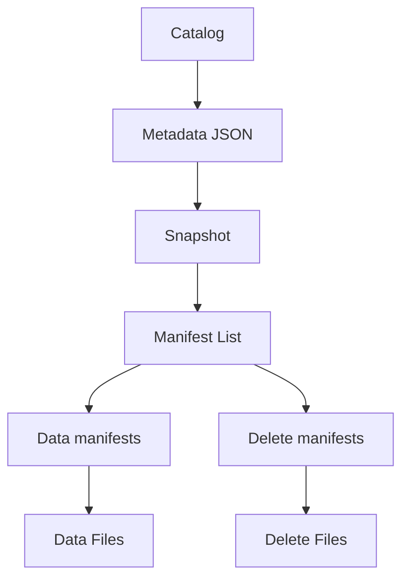

# Chapter 3 — Lakehouse / Iceberg

<!-- SOURCE CORE START -->

## 3.1 Lakehouse Architecture

Lakehouse는 데이터 레이크의 열린 저장소와 데이터 웨어하우스의 테이블 관리 기능을 함께 쓰는 구조다. 파일을 유연하게 쌓으면서도 하나의 표처럼 안전하게 조회·변경해야 할 때 유용하다.

큰 그림:

```text
Object Storage
   ↓
Parquet Files
   +
Table Format
   ↓
Iceberg
   ↓
Compute
Spark / Trino / Flink
   ↓
Catalog / Governance
```

주요 계층:

- Storage Layer
- Compute Layer
- Table Format
- Catalog
- Governance / Control Plane

각 계층이 맡는 일을 나란히 보면 저장 형식과 실행 엔진의 역할을 구분하기 쉽다.

| 계층 | 역할 |
| --- | --- |
| 객체 저장소(Object storage) | 파일을 지속적으로 보관 |
| 파일 형식(File format): Parquet 등 | 파일 안에 행과 열을 저장하는 방식 정의 |
| 테이블 형식(Table format): Iceberg 등 | 여러 파일을 하나의 일관된 테이블로 관리 |
| 연산 엔진(Compute): Spark·Trino·Flink 등 | 데이터 읽기·변환·쓰기 |
| 카탈로그(Catalog) | 테이블 이름으로 현재 메타데이터 위치 찾기 |
| Governance | 정책과 책임 관리 |

---

### Data Plane vs Control Plane

Data Plane:

- 실제 Parquet 파일
- 실제 Query / Read / Write

Control Plane:

- Metadata
- Catalog
- Access Policy
- Governance
- Table Definition

이렇게 구분하면 파일을 실제로 읽고 쓰는 작업과, 테이블 정의·권한을 관리하는 작업의 책임이 분명해진다.

계층 그림은 책임을 나눈 개념 모델이다. Compute 다음에만 Catalog가 실행된다는 직렬 처리 순서가 아니다. Catalog가 현재 metadata를 찾게 하고 엔진이 metadata와 실제 파일을 읽는다. Pruning 목록도 여러 최적화 계층을 보여 주며 반드시 같은 순서로 실행되는 것은 아니다.

---

## 3.2 Iceberg Metadata Internals

Iceberg의 핵심은 Parquet 파일 자체보다 **테이블 메타데이터**다. 메타데이터는 어떤 파일이 현재 테이블에 속하는지 적은 목록과 설명서로, 여러 엔진이 같은 테이블을 일관되게 읽도록 돕는다.

구조를 단순화하면:

```text
Iceberg Table
   ↓
Metadata JSON
   ↓
Snapshot
   ↓
Manifest List
   ↓
Manifest Files
   ↓
Data Files
```

SQL에서 `prod.db.orders`를 조회하면 하나의 주문 테이블이 보인다. 하지만 저장소에 그 이름의 거대한 파일 하나가 있는 것은 아니다. **카탈로그에 등록된 이름 → 현재 메타데이터 → 실제 데이터 파일들**을 연결해 하나의 테이블로 읽는다. 이런 묶음을 **논리적 테이블**이라고 한다.

아래 주문 테이블 예시를 따라가 보자. 경로와 파일명은 설명용이며, 실제 배치는 카탈로그와 엔진에 따라 달라진다.

```text
카탈로그: prod.db.orders
  → 현재 메타데이터: s3://lake/orders/metadata/v2.metadata.json

s3://lake/orders/
  metadata/v1.metadata.json       이전 테이블 상태
  metadata/v2.metadata.json       현재 테이블 상태
  metadata/snap-202-1.avro        스냅샷 202의 manifest list
  metadata/manifest-a.avro        data manifest
  data/orders-a.parquet           실제 행과 열
```

이 예시에서 카탈로그는 `v2.metadata.json`을 가리킨다. 파일명에 붙인 `v1`, `v2`는 예시의 메타데이터 개정 번호이며, Iceberg 테이블 포맷 버전과는 별개다.

**폴더에 있는 파일 목록과 현재 테이블이 읽는 파일 목록은 다르다.** 엔진은 현재 메타데이터의 참조를 따라 읽을 파일을 결정한다. 이전 파일도 과거 스냅샷이 사용할 수 있으므로, 폴더 목록만 보고 삭제하거나 테이블 상태를 판단하면 안 된다.

---

### Metadata JSON

Metadata JSON은 현재 테이블의 스키마, 파티션 규칙, 스냅샷 같은 상태를 설명한다. 데이터 파일을 직접 읽기 전에 확인하는 목차다.

앞서 본 `v2.metadata.json`을 열면 아래와 같은 정보를 확인할 수 있다. **Snapshot은 별도 JSON 파일이 아니라, 이 파일의 `snapshots` 배열 안에 있는 기록**이다.

다음 JSON은 파일 사이의 연결을 보여 주기 위해 일부 필드만 남긴 설명용 발췌다.

```json
{
  "current-snapshot-id": 202,
  "snapshots": [{
    "snapshot-id": 202,
    "manifest-list": "s3://lake/orders/metadata/snap-202-1.avro"
  }]
}
```

포함될 수 있는 정보:

- 현재 Snapshot
- Schema
- Partition Spec
- Sort Order
- Snapshot History

---

### Current Snapshot

현재 스냅샷은 지금 테이블에 속한 파일들의 일관된 집합을 가리킨다.

앞의 JSON은 다음 순서로 읽으면 된다. 이 예시는 Iceberg 테이블 포맷 v2를 기준으로 한다.

1. `current-snapshot-id`가 `202`이므로 현재 스냅샷은 202번이다.
2. `snapshots` 배열에서 `snapshot-id`가 `202`인 기록을 찾는다.
3. 그 기록의 `manifest-list` 경로를 따라 `snap-202-1.avro`를 읽는다.

---

### Snapshot Log

과거 Snapshot 이력을 기록한다.

따라서 Metadata JSON이 시간에 따라 여러 버전 존재할 수 있다.

질문:

> Iceberg에 Table Metadata가 여러 개일 수 있는가?

답:

> 가능하다. Table 상태 변화에 따라 새로운 Metadata 파일이 만들어지고 Catalog/metadata pointer가 현재 Metadata를 가리키는 방식으로 이해할 수 있다.

---

### Manifest List / Manifest File

Snapshot이 직접 모든 Data File을 하나씩 들고 있는 대신 중간 Metadata 계층을 사용한다.

개념:

```text
Snapshot
  ↓
Manifest List
  ↓
Manifest
  ↓
Data File
```

중간 목록이 파일 경로와 통계를 나누어 관리하므로, 큰 테이블에서도 모든 파일을 무작정 열지 않고 필요한 파일을 고를 수 있다.

앞에서 찾은 `snap-202-1.avro`가 **Manifest List**다. 이 파일은 실제 주문 데이터를 담지 않는다. 대신 읽어야 할 **Manifest File의 목록**을 담는다. Manifest File을 한 단계 더 따라가야 실제 데이터 파일의 경로가 나온다.

| 단계 | 예시 파일 | 담고 있는 내용 |
| --- | --- | --- |
| Manifest List | `snap-202-1.avro` | Manifest File의 경로와 요약 정보 |
| Manifest File | `manifest-a.avro` | Data File 또는 Delete File의 경로와 통계 |
| Data File | `orders-a.parquet` | 실제 주문 행과 열: 쿼리 결과를 만드는 데이터 |

**파일 안의 필드를 따라 읽기**

포맷 v1–v3에서 Manifest List와 Manifest File은 모두 **Avro 바이너리 파일**이다. 아래 설명은 파일을 해석한 결과이며, 파일에 그대로 적힌 텍스트가 아니다.

- **Manifest List의 레코드 하나**는 `manifest_path`로 Manifest File 하나를 가리킨다. 예시에서는 `manifest-a.avro`다. 파일 크기(`manifest_length`), 파티션 규칙 ID(`partition_spec_id`), 파일 수, 파티션 범위도 요약해 둔다. Manifest List는 스냅샷마다 작성된다.
- **Manifest File의 항목 하나**는 `data_file.file_path`로 데이터 파일 또는 삭제 파일을 가리킨다. 예시에서는 `orders-a.parquet`다. 파일 형식, 행 수(`data_file.record_count`), 크기와 선택적인 열 통계도 담는다.
- 항목의 `status`는 추가·기존·삭제 상태를 구분한다. 예를 들어 `status=1`(ADDED), `snapshot_id=202`인 항목은 스냅샷 202에서 추가된 파일을 나타낸다.

이렇게 목록과 통계를 나누면 필요한 파일을 골라 읽을 수 있다. 다음 스냅샷에서도 바뀌지 않은 Manifest와 Data File은 재사용할 수 있다.

**버전 범위**

위 예시는 포맷 v2를 기준으로 하며, v1–v3에서도 이 연결 구조를 사용할 수 있다. 다만 v1에서는 Manifest List 없이 스냅샷의 `manifests` 배열에 Manifest 경로를 직접 담는 방식도 허용된다.

포맷 v4에서는 Manifest List 대신 Parquet 형식의 **Root Manifest**를 사용한다. 따라서 Avro 파일로 이어지는 위 구조를 모든 버전에 그대로 적용하면 안 된다. [스냅샷 사양](https://iceberg.apache.org/spec/#snapshots), [Manifest List 사양](https://iceberg.apache.org/spec/#manifest-lists), [Manifest 필드 사양](https://iceberg.apache.org/spec/#manifest-schema)

**실제 테이블에서 확인하기**

Spark에서는 다음 메타데이터 테이블로 참조 경로를 확인할 수 있다. 지원 여부는 사용하는 엔진과 Iceberg 버전에 따라 확인한다. [Spark 메타데이터 테이블 문서](https://iceberg.apache.org/docs/latest/spark-queries/#metadata-tables)

- `.snapshots`: 스냅샷의 `manifest_list` 경로
- `.manifests`: Manifest File의 경로
- `.entries`: Manifest File 안의 개별 항목

```sql
SELECT * FROM prod.db.orders.snapshots;
SELECT * FROM prod.db.orders.manifests;
SELECT * FROM prod.db.orders.entries;
```

---

### Data Files

실제 데이터가 있는 Parquet/ORC/Avro 파일.

### Delete Files

Merge-on-Read 같은 방식에서 삭제 정보를 별도 파일로 관리할 수 있다.

과거 metadata 파일이 남아 있어도 그 파일이 현재 table 상태를 가리킨다는 뜻은 아니다. Manifest는 data file 또는 delete file과 그 metadata를 설명한다.

카탈로그부터 실제 파일까지의 참조 관계를 펼치면 다음과 같다. 이 그림은 별도 delete file을 사용하는 v2 테이블의 예다. Snapshot은 Metadata JSON 안의 기록이며, data manifest와 delete manifest는 서로 다른 파일이다. 화살표는 참조 관계를 나타내며 데이터 복사 순서가 아니다.



---

## 3.3 Snapshot Semantics

Snapshot(스냅샷)은 특정 시점의 테이블 전체 상태를 가리키는 기록이다. 책의 새 판본을 만들 때 목차는 갱신하되 바뀌지 않은 페이지는 다시 복사하지 않고 함께 쓴다고 생각하면 된다.

중요한 점:

> Snapshot마다 모든 파일을 새로 복사하는 것이 아니다.

여러 Snapshot이 동일한 Data File을 공유할 수 있다.

```text
Snapshot 1
→ A, B, C

Snapshot 2
→ A, B, C, D
```

A/B/C는 그대로 공유되고 D만 추가될 수 있다.

---

### Time Travel

과거 Snapshot을 기준으로 Query할 수 있다.

### Rollback

Table을 과거 Snapshot 상태로 되돌릴 수 있다.

### Consistent Read

쿼리는 시작할 때 선택한 스냅샷을 기준으로 읽는다. 쓰기가 동시에 진행돼도 절반만 바뀐 테이블을 보지 않도록 하는 경계다.

### Snapshot Isolation Intuition

동시에 Write가 발생하더라도 Query는 중간 상태가 아니라 특정 Snapshot의 일관된 상태를 읽는다고 이해하면 된다.

---

## 3.4 Atomic Commit Model

여러 작성자(Writer)가 동시에 테이블을 바꿀 수 있다. Iceberg의 **낙관적 동시성 제어(Optimistic Concurrency)**는 먼저 작업하고 커밋할 때 충돌을 확인하므로 동시 쓰기에서 중간 상태를 공개하지 않도록 돕는다.

개념적으로:

```text
현재 Metadata = M1

Writer A
→ M1 기준 변경

Writer B
→ M1 기준 변경
```

한 Writer가 먼저 Commit하면 현재 Metadata가 바뀐다.

나중에 커밋하려는 작성자는 먼저 현재 상태가 바뀌었는지 확인한다:

- Conflict 확인
- 필요한 경우 retry

할 수 있다.

---

### Compare-and-Swap Intuition

"내가 작업을 시작했을 때의 Table 상태가 아직 현재 상태인가?"를 확인하고 Commit한다고 이해하면 된다.

---

### Orphan Files

File은 만들어졌는데 Commit에 실패하면 Table Metadata에서 참조되지 않는 파일이 남을 수 있다.

이런 File은 나중에 cleanup 대상이 된다.

원자적 커밋을 실제로 구현하는 방식은 카탈로그에 달려 있다. 충돌이 발생했다고 무조건 재시도하면 성공하는 것은 아니다. 충돌의 원인과 해당 카탈로그의 동작을 확인해야 한다. [Iceberg 사양](https://iceberg.apache.org/spec/)

---

## 3.5 Partitioning in Iceberg

Iceberg의 **숨겨진 파티셔닝(Hidden Partitioning)**은 파일 묶음을 나누는 규칙을 쿼리 작성자에게 숨긴다. 사용자는 날짜 열로 검색하고 Iceberg는 내부 변환 규칙을 이용해 필요한 묶음만 찾는다.

사용자는 Query에서 Partition Column을 직접 의식하지 않고 논리 column 조건을 사용할 수 있다.

예:

```sql
WHERE event_time >= ...
```

Iceberg가 내부 Partition Transform을 이용해 Pruning할 수 있다.

---

### Partition Transforms

대표:

- day
- hour
- bucket
- truncate

예:

```text
day(event_time)
bucket(32, user_id)
```

---

### Partition Evolution

파티션 규칙(Partition Spec)이 바뀌어도 과거 파일 전체를 다시 쓰지 않고 새 파일부터 다른 규칙을 적용할 수 있다.

예:

```text
기존: day(event_time)
변경: hour(event_time)
```

과거 데이터와 새 데이터가 서로 다른 Partition Spec을 사용해도 Metadata를 통해 관리할 수 있다. 다만 규칙을 바꾸는 것만으로 기존 파일이 새 규칙에 맞게 자동 재배치되지는 않는다.

---

### High Cardinality Design

`user_id`처럼 cardinality가 높은 값은 직접 Partition하지 않고 bucket transform 등을 고려할 수 있다.

Partition transform의 실제 SQL 표기는 engine에 따라 다르다.


---

## 3.6 Query Pruning

Iceberg 쿼리 성능의 핵심은 **프루닝(Pruning)**, 즉 조건에 맞지 않는 파일이나 데이터 범위를 읽기 전에 건너뛰는 것이다.

> **얼마나 적은 데이터를 읽게 할 수 있는가**

Pruning 단계:

```text
Partition Pruning
   ↓
Manifest Pruning
   ↓
Data File Pruning
   ↓
Parquet Row Group Pruning
   ↓
Column Pruning
```

---

### Scan Amplification

필요한 결과는 적은데 파일을 많이 읽는 현상을 **스캔 증폭(Scan Amplification)**이라고 한다. 예를 들어 한 고객의 기록을 찾느라 모든 파일을 훑는 경우다.

좋은 Layout은 이를 줄인다.

---

## 3.7 Sort Order and Clustering

파일의 최솟값·최댓값 통계를 잘 쓰려면 자주 조회하는 값이 어느 정도 모여 있어야 한다. 예를 들어 `user_id` 범위 조회가 많으면 관련 값이 함께 저장된 파일을 더 쉽게 골라낼 수 있다.

예:

```text
random user_id distribution
```

보다:

```text
user_id 순으로 어느 정도 정렬
```

되어 있으면 특정 user 범위를 찾을 때 File Pruning이 더 유리할 수 있다.

핵심:

> **Sort / Clustering은 Query Pattern을 기준으로 설계해야 한다.**

User ID가 모든 파일에 무작위로 분포하면 넓은 min/max 범위가 겹칠 수 있다. 정렬은 그 범위를 좁혀 특정 사용자나 사용자 범위를 읽을 때 도움이 될 수 있다.


---

## 3.8 UPDATE / DELETE / MERGE

객체 저장소의 Parquet 파일은 일반 데이터베이스의 한 행처럼 즉시 수정하기 어렵다. Iceberg는 UPDATE·DELETE·MERGE를 테이블 수준에서 지원하지만 변경량과 읽기 비용에 맞는 방식을 골라야 한다.

---

### Copy-on-Write

변경된 row가 포함된 Data File을 다시 작성한다.

장점:
- 읽기가 단순

단점:
- Write 비용 증가

---

### Merge-on-Read

원본 Data File은 유지하고 변경/삭제 정보를 별도 파일로 저장한 뒤 Read할 때 합친다.

장점:
- 빠른 Write 가능

단점:
- Read가 복잡해질 수 있음
- Delete File 관리 필요

---

### Position Delete

아래 Position Delete와 Equality Delete는 주로 포맷 v2의 모델이다. 이후 포맷에는 deletion vector 같은 다른 표현도 있으므로 엔진과 테이블 버전의 지원 범위를 확인한다. [Iceberg 사양](https://iceberg.apache.org/spec/)

Position Delete는 특정 파일의 특정 행 위치를 삭제 대상으로 기록한다. 읽을 때 그 위치를 건너뛴다.

### Equality Delete

Equality Delete는 키나 값 조건에 맞는 행을 삭제 대상으로 기록한다. 파일 내 행 위치를 몰라도 조건으로 찾는다.

---

### UPDATE

개념적으로:

```text
기존 row 삭제
+
새 row 삽입
```

처럼 이해할 수 있다. 삭제 정보만 기록하는 것으로는 새 값이 생기지 않으므로, 변경된 값은 데이터 파일에도 써야 한다.

### MERGE

CDC Upsert 등에 사용 가능하지만 큰 Table에서는 비용을 고려해야 한다.

큰 테이블의 MERGE는 상당한 scan·shuffle·rewrite를 일으킬 수 있다. 지원 연산과 물리적 delete 표현은 table format 버전과 engine에 따라 확인한다.


---

## 3.9 Maintenance

Lakehouse는 파일이 쌓이는 구조라 **유지보수(Maintenance)**가 필요하다. 작은 파일·삭제 파일·오래된 스냅샷이 늘면 쓰기와 조회가 느려지거나 저장 비용이 커질 수 있다.

### Data File Compaction

작은 Data File들을 적절한 크기로 합친다.

### Delete File Rewrite

Delete File이 너무 많이 쌓이면 Rewrite한다.

### Manifest Rewrite

Manifest가 비효율적으로 많아질 경우 재정리한다.

### Snapshot Expiration

오래된 Snapshot을 제거한다.

### Orphan Cleanup

Metadata에서 더 이상 참조되지 않는 File을 제거한다.

핵심:

> **Iceberg를 도입했다고 Maintenance가 사라지는 것은 아니다.**

현재 snapshot에 없는 파일도 유지 중인 과거 snapshot이 참조할 수 있다. Orphan 정리는 진행 중인 write보다 충분히 긴 보존 여유와 경로 일치 검증이 필요하다. 너무 이른 삭제는 데이터 손상을 일으킬 수 있다. Snapshot expiration은 time travel/rollback 가능 범위도 줄인다. [Iceberg 유지보수](https://iceberg.apache.org/docs/latest/maintenance/)

---

## 3.10 Catalogs

Iceberg 테이블을 열려면 현재 메타데이터가 어디 있는지 알아야 한다. **카탈로그(Catalog)**는 도서관 검색대처럼 테이블 이름을 현재 메타데이터 위치에 연결한다.

Catalog의 역할:

- Table 이름 등록
- 현재 Metadata 위치 관리
- Namespace 관리

대표 Catalog:

- Hive Metastore
- AWS Glue
- REST Catalog
- JDBC Catalog
- Nessie
- Unity Catalog concepts

---

## 3.11 Catalog vs Governance

카탈로그는 테이블을 찾게 하고, **거버넌스(Governance)**는 누가 무엇을 볼 수 있는지 같은 사용 규칙을 관리한다. 실제 제품은 두 역할을 함께 제공할 수도 있다.

### Catalog 기본 역할

```text
table name
→ current metadata
```

같은 Table Registration / Discovery.

### Governance

더 넓은 역할:

- Access Policy
- Ownership
- Classification
- Audit
- Lineage
- Masking

---

### Unity Catalog와 Iceberg Catalog

질문:

> Unity Catalog는 Iceberg Catalog에 여러 정보를 추가한 형태인가?

단순히 동일하다고 보기는 어렵다.

개념적으로:

```text
Iceberg Catalog
→ Iceberg Table을 찾고 Metadata pointer를 관리

Unity Catalog
→ Catalog 기능 + Access Control + Lineage + Governance + 여러 Data/AI Asset 관리
```

즉 Unity Catalog는 훨씬 넓은 Governance Layer로 이해하는 것이 맞다.

Unity Catalog는 data/AI 자산의 접근 제어·lineage·audit 등을 포함하는 governance 계층이다. Iceberg 연동 가능 여부와 지원 방식은 실제 환경에서 따로 확인한다. [Databricks Unity Catalog](https://docs.databricks.com/aws/en/data-governance/unity-catalog/)

---

<!-- SOURCE CORE END -->

## 처음 읽는 사람을 위한 연결

[3.1](#31-lakehouse-architecture)과 [3.2](#32-iceberg-metadata-internals)를 도서관에 비유하면, object storage는 책을 놓는 공간, Parquet은 책의 내부 형식, Iceberg metadata는 현재 책 목록과 판본을 가리키는 기록이다. Snapshot은 특정 시점의 테이블 상태를 가리키는 목록이고, pruning은 쿼리에 필요 없는 파일을 건너뛰는 일이다. Catalog는 그 기록의 위치를 찾게 한다. 실제 시스템에서는 파일·metadata·catalog의 책임이 다르므로 한 요소만 복구해서 테이블 전체가 정상이라고 판단하면 안 된다.

예를 들어 주문 테이블을 수정하면 새 data/delete file을 쓴 뒤 [3.4](#34-atomic-commit-model)의 commit으로 새 snapshot을 공개한다. 분석 엔진은 그 snapshot이 참조하는 파일을 읽는다. 이 흐름을 알면 [3.6](#36-query-pruning)의 읽기 범위 축소와 [3.9](#39-maintenance)의 오래된 파일 정리를 언제 검토할지 연결할 수 있다. 파일 삭제 전에는 유지 중인 snapshot과 진행 중인 쓰기를 확인한다.

## 연결해서 읽기

[파일과 partition 기초](foundations.md), [Spark](spark.md), [Flink](flink.md).

## 핵심 정리

- Iceberg는 파일 자체가 아니라 파일·snapshot·schema를 설명하는 테이블 metadata와 commit 규칙을 제공한다.
- Partition·정렬·pruning은 필요한 파일을 덜 읽도록 돕지만, 실제 효과는 데이터 배치와 쿼리 조건에 달려 있다.
- 수정·정리·복구에서는 현재 snapshot뿐 아니라 과거 참조와 진행 중인 작업까지 확인한다.

## LLM 실전: Commit 실패 분석

**프롬프트:**

=== "한국어"

    ```text {.prompt}
    가상 concurrent writer 작업에서 commit 충돌과 참조되지 않는 파일이 보인다.
    Commit 실패를 분석하고 관찰·충돌 가설·누락 근거를 나눠 줘.
    아직 참조 중일 수 있는 파일을 식별해 줘.
    자료를 검토하되 실제 변경은 실행하지 마.
    ```

=== "English"

    ```text {.prompt}
    A hypothetical concurrent-write workload shows commit conflicts and apparently unreferenced files.
    Assess the commit failures.
    Separate observations, conflict hypotheses, and missing evidence.
    Identify files that may still be referenced.
    Review the material; do not apply changes.
    ```

**핵심 사항:** LLM은 현재 스냅샷에 없는 파일을 곧바로 orphan으로 잘못 분류할 수 있다. 삭제 후보를 판단하기 전에 유지 중인 모든 스냅샷과 진행 중인 쓰기를 확인한다. 충돌 가설은 카탈로그의 공식 동작 설명과 실제 로그를 대조해 검토한다.

[이 주제의 실무 프롬프트 6개 더 보기](../prompts/lakehouse-iceberg.md)

LLM 출력은 작업 가설이다. 공식 문서와 실제 설정·로그·측정으로 검증한다. 외부 문서 확인일: 2026-10-18. 구현 버전을 시험했다는 의미는 아니다.
