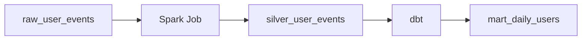
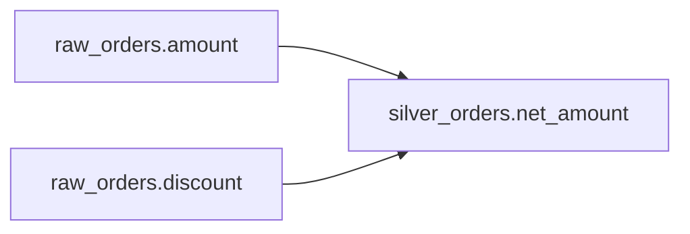

# Chapter 13 — Lineage & Metadata Platform

이 장은 metadata, lineage, catalog의 역할을 다룬다. 예시는 가상 데이터셋이며 수집기나 플랫폼을 구축해 검증한 기록이 아니다. Metadata는 데이터를 설명하는 데이터이고, lineage는 데이터가 생성되고 사용되는 경로다.

<!-- SOURCE CORE START -->

## 13.1 Metadata Types

메타데이터(metadata)는 책의 제목·저자·분류처럼 데이터 자체를 설명하는 정보다. 데이터의 구조, 최근 실행 상태, 업무상 뜻은 서로 다른 종류이므로 함께 확인해야 안전하게 사용할 수 있다. 예를 들어 `orders.amount`의 타입뿐 아니라 마지막 갱신 시각과 매출 계산에 쓰이는지까지 알아야 한다.

Metadata:

> **데이터를 설명하는 데이터**

### Technical Metadata

- Table
- Column
- Type
- Schema
- Partition
- File Format

기술 메타데이터가 답하는 질문:

> 구조가 어떻게 생겼는가?

### Operational Metadata

- Last Updated
- Job Status
- Freshness
- Row Count
- Processing Time

운영 메타데이터가 답하는 질문:

> 지금 정상적으로 운영되는가?

### Business Metadata

- Description
- Owner
- KPI Definition
- Business Term
- Classification

업무 메타데이터가 답하는 질문:

> 이 데이터는 업무적으로 무엇을 의미하는가?

---

## 13.1A Business Metadata vs Semantic Layer

Business metadata는 지표가 무엇을 뜻하는지 설명하고 semantic layer는 여러 질의가 같은 계산 정의를 재사용하도록 돕는다. 레시피 카드에 “매출”의 의미를 적는 것과 실제 재료·계산 순서를 정하는 차이에 가깝다. 아래 식은 개념 예시이며 실제 회계 규칙이나 바로 실행할 SQL이 아니다.

학습 중 나온 질문:

> Business Metadata는 Semantic Layer와 유사해 보인다.

두 개념은 의미를 다루지만 쓰임이 다르다:

> **겹치는 부분은 많지만 동일하지 않다.**

Business Metadata:

> 데이터의 의미를 설명.

예:

```text
Revenue
→ VAT 제외
→ Refund 제외
→ Owner: Finance
```

Semantic Layer:

> 의미를 실제 계산 가능한 Metric/Dimension 정의로 제공.

예:

```text
Revenue
=
SUM(order_amount)
- SUM(refund)
- SUM(vat)
```

관계:

```text
Business Metadata
→ "Revenue가 무엇인가?"

Semantic Layer
→ "Revenue를 어떻게 계산하는가?"

BI / Dashboard / AI
→ 동일 정의 사용
```

Semantic layer는 business metadata의 뜻을 쿼리에서 재사용할 수 있는 **계산 정의**로 구체화한다.

Revenue 식은 개념 예시이며 실제 회계 규칙이나 특정 제품의 실행 문법이 아니다.

실제로 적용하려면 grain, 기간, 통화, 중복 차감 여부를 합의해야 한다. 설명만으로 실행 계산식을 확정하지 않는다.

---

## 13.2 Dataset Lineage

Lineage(계보)는 데이터가 어떤 원본과 작업을 거쳐 만들어져 어디에 쓰이는지 기록한 경로다. 수도꼭지의 물이 이상하면 배관을 거슬러 원인을 찾고, 배관을 고치기 전에는 어느 수도꼭지가 영향을 받는지 확인하는 것과 비슷하다. 예를 들어 대시보드의 일별 사용자 수가 틀리면 이 경로를 거슬러 원본 이벤트와 변환 작업을 찾는다. 변경 전에는 반대로 경로를 따라 영향을 받을 소비자를 찾는다.

Dataset lineage는 다음 관계를 보여 준다:

> **Source → Job → Target 관계**

예:

```text
raw_user_events
 ↓
Spark Job
 ↓
silver_user_events
 ↓
dbt
 ↓
mart_daily_users
```

화살표를 오른쪽으로 따라가면 파생 결과를, 왼쪽으로 거슬러 가면 원본과 변환 작업을 찾을 수 있다.



### Upstream

현재 데이터의 원본과 이를 만든 작업이다.

### Downstream

현재 데이터를 읽거나 그 결과에 의존하는 쪽이다.

활용:

- Root Cause
- Impact Analysis
- Data Trust

---

## 13.3 OpenLineage

OpenLineage는 여러 도구가 계보 정보를 공통 형식으로 내보내고 읽도록 돕는 표준이다. Job은 작업 정의, run은 한 번의 실행, dataset은 입력 또는 출력이다. 다만 job·dataset 메타데이터 이벤트가 항상 run 하나에 속하는 것은 아니다. 표준을 사용해도 실제 수집 범위는 연동별로 확인한다.

OpenLineage:

> **서로 다른 Data Tool이 Lineage 정보를 공통 형식으로 표현하는 표준**

핵심 Entity:

### Job

어떤 작업인가.

### Run

특정 Job의 실행 1회.

### Dataset

Input / Output Data.

예:

```text
bronze.orders
 ↓
Job: transform_orders
 ↓
silver.orders
```

OpenLineage는 결과를 보여 주는 화면이 아니라 계보 이벤트를 표현하는 **표준**이다.

OpenLineage는 실행 이벤트와 metadata 표현을 정의한다. 공식 문서에서 확인한 object model은 run에 연결되지 않는 job/dataset metadata event도 지원한다. 모든 lineage event가 실행 1회만을 표현한다고 한정하면 안 된다. [OpenLineage object model](https://openlineage.io/docs/spec/object-model/)

OpenLineage와 [Marquez](https://marquezproject.ai/)의 설명은 2026-09-24에 공식 문서로 확인했다. 연결 도구를 설치했다는 사실만으로 모든 실행과 column lineage가 수집된다고 가정하지 않는다. 실제 수집 범위를 별도로 확인한다.

---

## 13.4 Column-Level Lineage

Column-level lineage는 “어느 테이블을 읽었나”보다 한 단계 더 들어가 “어느 열이 결과 열에 쓰였나”를 보여 준다. `net_amount`에 `amount`와 `discount`가 쓰이면 두 원본 열의 변경을 우선 검토할 수 있다. 수집되지 않은 SQL이나 동적 변환은 그래프에 빠질 수 있다.

예:

```text
raw_orders.amount ────┐
                      ├→ silver_orders.net_amount
raw_orders.discount ──┘
```

활용:

- KPI Root Cause
- Schema Change Impact
- Sensitive Data Tracking

두 원본 열이 하나의 결과 열에 함께 영향을 주는 관계를 그림으로 보면 다음과 같다. 화살표는 의존성을 나타내며 계산식 자체를 정의하지는 않는다.



---

## 13.5 Impact Analysis

Impact analysis(영향 분석)는 변경이나 장애가 어디에서 시작했고 어디까지 퍼질 수 있는지 확인한다. Upstream은 원인을 거슬러 보는 방향, downstream은 소비자로 내려가는 방향이다. 타입 변경을 승인하기 전에는 그래프뿐 아니라 실제 SQL과 소비자의 기대 타입도 확인한다.

### Upstream Analysis

문제의 원본과 이전 변환을 거슬러 확인한다.

### Downstream Impact Analysis

바뀐 데이터가 어떤 변환과 소비자에게 이어지는지 확인한다.

예:

```text
raw_orders.amount type 변경
 ↓
stg_orders
 ↓
fact_sales
 ↓
mart_daily_sales
 ↓
Dashboard
```

연결이 존재한다는 사실만으로 특정 실행이 정확했음을 증명하지는 않는다. Lineage에 누락이 있을 수 있으므로 그래프에 없다는 이유만으로 영향이 없다고 확정하지 않는다.

`raw_orders.amount` type 변경 예에서는 각 downstream 변환과 소비자의 기대 타입을 확인한다.

---

## 13.6 Marquez

Marquez는 OpenLineage 정보를 모아 실행과 데이터셋의 관계를 찾아보는 도구다. 도로 표준과 지도가 다르듯 OpenLineage는 이벤트 형식, Marquez는 수집·조회 화면의 예다. 도구를 설치한 사실만으로 모든 실행·열 관계가 수집됐다고 볼 수 없다.

Marquez:

> **OpenLineage Event를 저장하고 조회/시각화하는 Lineage System**

관계:

```text
OpenLineage
→ 표준

Marquez
→ 수집/저장/UI/API
```

Marquez는 Catalog 전체보다 Lineage/Run 관계에 초점이 강하다.

---

## 13.7 Catalog Integration

Catalog(카탈로그)는 여러 출처의 메타데이터를 한곳에서 찾게 하는 안내 목록이다. 새 지표를 쓰기 전에 설명·소유자·품질·상하류 경로를 함께 볼 수 있다. 다만 정책이 catalog에 표시된다고 모든 쿼리 엔진과 직접 저장소 접근에서 자동으로 강제되는 것은 아니다.

```text
Iceberg
→ Technical Metadata

dbt
→ Model / Documentation / Dependencies

Airflow
→ Pipeline / Runs

OpenLineage
→ Lineage

Quality Tool
→ Data Quality
```

Catalog에서 볼 수 있는 정보:

- Description
- Owner
- Freshness
- Quality
- Upstream / Downstream
- Classification
- Access Policy

현대 Catalog는 단순 Table 목록이 아니라:

```text
Discovery
+
Metadata
+
Lineage
+
Governance
```

로 발전한다.

13.7의 통합 흐름은 정보 출처의 역할을 설명한다. 자동 연결을 보장하는 제품 구성도가 아니다.

정책을 표시하는 것과 실제 데이터 접근을 강제하는 것은 별개다. [거버넌스](governance.md)에서는 실행 엔진과 storage 접근 경로까지 확인한다.

---

<!-- SOURCE CORE END -->

## 이 장의 핵심

- 메타데이터는 데이터의 뜻과 상태를 설명하고, lineage는 생성·사용 경로를 추적한다.
- 타입이나 지표 정의를 바꿀 때 upstream 근거와 downstream 소비자를 함께 확인한다.
- 수집되지 않은 연결과 실제 실행·정책 적용 여부는 catalog 그림만으로 판단할 수 없다.

## LLM in Practice: 타입 변경 영향 검토

**프롬프트:**

=== "한국어"

    ```text {.prompt}
    가상의 `raw_orders.amount` 타입 변경을 검토한다.
    재설계를 제안하기 전에 이 타입 변경안을 평가하세요.
    downstream 영향 후보와 확인할 upstream 근거를 나열하고, 사실·가정·누락 의존성을 구분하세요.
    자료를 검토하되 실제 변경은 실행하지 마.
    ```

=== "English"

    ```text {.prompt}
    Review a proposed type change to hypothetical `raw_orders.amount`.
    Assess this proposed type change before suggesting a redesign.
    List likely downstream impacts and upstream evidence to inspect.
    Separate facts, assumptions, hypotheses, and missing dependencies.
    Review the material; do not apply changes.
    ```

**핵심 사항:** 영향을 받을 변환·KPI·대시보드와 확인할 증거, 수집 누락 때문에 확정할 수 없는 범위를 나눈 검토안이다. 관측된 lineage를 전체 의존성으로 가정하거나 business description만으로 실행 계산식을 추정할 수 있다. 실제 SQL과 실행 설정, 수집 이벤트, catalog 정보, 샘플 결과를 대조한다. LLM의 추정을 변경 승인이나 완전한 영향 분석으로 취급하지 않는다.

[데이터 관측성](data-observability.md) · [거버넌스](governance.md) · [핸드북 홈](../index.md)

[더 많은 실무 프롬프트](../prompts/lineage-metadata.md)
