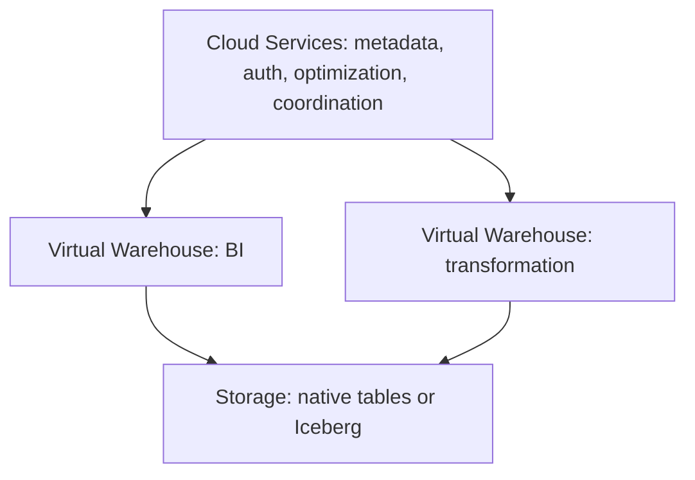

# Chapter 18 — Snowflake Deep Dive (Condensed)

<!-- SOURCE CORE START -->

> 원문 학습에서는 사용자가 Snowflake를 한 번 요약한 뒤 넘어가도록 명시적으로 요청했다.

Snowflake는 다음과 같이 요약할 수 있다:

> **Storage와 compute를 분리한 관리형 클라우드 데이터 플랫폼. 역사적으로 SQL/Data Warehouse workload를 중심으로 발전했으며, 이제 data engineering, Iceberg, governance, AI로 확장했다.**

---

## 18.1 Architecture

Snowflake는 저장소, 계산 자원인 Virtual Warehouse, 조정 기능인 Cloud Services를 나눈다. 같은 데이터에 여러 업무가 접근하되 계산 자원을 따로 운영하고 싶을 때 이 구분이 중요하다.

```text
Cloud Services
     ↓
Virtual Warehouses
     ↓
Storage
```

### Storage

저장 계층은 Snowflake가 관리하는 데이터 또는 Iceberg 관련 객체 저장소를 담는다. 계산 자원을 쉬게 해도 데이터는 별도로 남는다.

### Virtual Warehouse

Virtual Warehouse는 쿼리와 DML(데이터 변경 명령)을 실행하는 독립 계산 자원이다. 팀별 작업대를 따로 두는 것처럼 업무 간 자원 간섭을 줄인다.

서로 다른 warehouse를 통해 workload를 격리한다.

### Cloud Services

담당하는 기능:

- Metadata,
- 인증,
- Query 최적화,
- 접근 제어,
- 작업 조정.

---

## 18.2 Micro-partitions

Snowflake는 테이블 데이터를 작은 물리 묶음인 **micro-partition**으로 자동 구성한다. 도서관의 책을 여러 서가에 나누어 두듯, 어느 묶음에 어떤 값이 있는지 기록해 필요한 것만 읽도록 돕는다.

```text
Table
├─ Micro-partition 1
├─ Micro-partition 2
├─ Micro-partition 3
└─ ...
```

Snowflake는 값 범위 등의 metadata를 추적한다.

쿼리 조건이 기록된 값 범위와 겹치지 않으면 해당 묶음을 읽지 않는 프루닝에 이 정보를 쓴다.

---

## 18.3 Pruning

**프루닝(Pruning)**은 쿼리 조건에 맞을 수 없는 데이터 묶음을 읽기 전에 제외하는 것이다. 예를 들어 날짜가 9월 26일인 행만 찾는다면 다른 날짜만 담긴 묶음을 건너뛸 수 있다.

```sql
WHERE event_date = '2026-09-26'
```

Snowflake는 조건과 일치할 수 없는 micro-partition을 읽지 않을 수 있다.

개념적으로 다음과 목적이 비슷하다:

```text
Iceberg File Pruning
Parquet Row Group Pruning
```

---

## 18.4 Clustering

자주 거는 필터와 실제 데이터 배치가 어긋나면 **클러스터링(Clustering)**으로 비슷한 값을 모아 프루닝 효율을 높일 수 있다. 큰 테이블에서 조회 패턴과 유지 비용을 함께 보고 결정한다.

큰 table에서는 clustering key를 사용할 수 있다.

목적은 모든 것을 수동 partition하는 것이 아니라 query pattern에 맞게 물리 배치를 개선하는 것이다.

---

## 18.5 Streams

**Stream**은 테이블의 행 변경을 추적해 지난 처리 이후의 변화만 읽도록 돕는다. 전체 테이블을 매번 다시 처리하기 어려운 증분 작업에 쓴다.

```text
Table
 ↓
Stream
 ↓
Change Data
```

예를 들어 새 주문만 집계한다면 전체 주문 테이블을 다시 읽는 대신 Stream이 가리키는 변경을 처리할 수 있다.

---

## 18.6 Tasks

**Task**는 SQL 작업을 시간표나 조건에 따라 실행한다. 예를 들어 Stream의 새 변경을 읽어 대상 테이블에 MERGE하는 작업을 예약할 수 있다.

자주 사용하는 조합:

```text
Stream
 ↓
Task
 ↓
MERGE / SQL Transform
```

---

## 18.7 Dynamic Tables

**Dynamic Table**은 원하는 쿼리 결과와 목표 신선도(freshness)를 선언하면 Snowflake가 갱신을 관리하는 테이블이다. 원본에서 Silver·Gold를 지속적으로 만들 때 사용한다.

> **Query 결과와 원하는 freshness를 선언하면 Snowflake가 refresh를 관리한다.**

예:

```text
Raw
 ↓
Dynamic Table
 ↓
Silver
 ↓
Dynamic Table
 ↓
Gold
```

Target lag를 사용한다:

```text
TARGET_LAG = 10 minutes
```

작업 순서를 하나씩 짜기보다 원하는 결과와 갱신 목표를 적는 **선언형 파이프라인**에 가깝다. 실제 지연은 작업량과 설정에 따라 달라진다.

---

## 18.8 Snowpipe / Snowpipe Streaming

**Snowpipe**는 객체 저장소에 들어온 파일을 Snowflake로 수집한다. **Snowpipe Streaming**은 staged file에만 의존하지 않고 더 낮은 지연의 연속 수집이 필요할 때 검토한다.

```text
Object Storage File
 ↓
Snowpipe
 ↓
Snowflake
```

Snowpipe Streaming은 staged file에만 의존하지 않고 더 낮은 지연으로 지속적인 수집을 가능하게 한다.

---

## 18.9 Iceberg Tables

Snowflake는 Apache Iceberg 테이블을 사용해 객체 저장소의 데이터를 여러 엔진과 연결할 수 있다. 다만 실제 공유 범위는 테이블 유형·카탈로그 설정·기능 지원을 확인해야 한다.

```text
Snowflake
 ↓
Iceberg Table
 ↓
Object Storage
```

Snowflake와 Horizon은 Iceberg 카탈로그 흐름에 참여할 수 있다. 테이블이 있는 위치와 현재 상태를 여러 도구가 찾게 하는 연결 지점이다.

Spark와 Trino 같은 외부 엔진도 열린 Iceberg workflow에 참여할 수 있다.

---

## 18.10 Governance — Horizon Catalog

**Horizon Catalog**는 데이터 찾기와 메타데이터, 접근 정책 같은 거버넌스 기능을 묶는다. 담당자가 같은 데이터를 찾더라도 역할에 따라 볼 수 있는 범위를 관리할 때 필요하다.

```text
Databricks
→ Unity Catalog

Snowflake
→ Horizon Catalog
```

Horizon이 제공하는 영역:

- Discovery,
- Metadata,
- Lineage,
- Classification,
- Masking,
- Row access,
- Governance,
- Iceberg 가시성,
- Semantic/business 맥락.

---

## 18.11 Cortex / AI

**Cortex** 등 AI 기능은 관리되는 기업 데이터 가까이에서 검색·분석·에이전트 기능을 활용하려는 방향이다. 실제 지원 범위와 비용은 선택한 서비스에서 확인한다.

```text
Cortex AI
Search
Analyst
Agents
AI interfaces
```

제품의 전체 방향은 다른 업계 흐름과 비슷하다:

> 거버넌스가 적용된 기업 데이터 가까이에서 AI를 사용하도록 한다.

---

## 18.12 Cost Model

Snowflake 비용은 Virtual Warehouse 계산뿐 아니라 serverless 기능, Cloud Services, 저장소에서도 생긴다. 쿼리 빈도와 자동 중지 설정을 함께 보면 불필요한 계산 시간을 줄일 수 있다.

```text
Virtual Warehouse
```

과금은 credit 기반이다.

비용 항목:

```text
Warehouse Compute
Serverless Compute
Cloud Services
Storage
```

최적화:

```text
Auto Suspend
Right-size Warehouse
Reduce Scan
Efficient Queries
Use incremental refresh where possible
```

---

## 18.13 Snowflake Mental Model

Snowflake를 기억할 때는 데이터 저장, Virtual Warehouse 계산, micro-partition 배치, 프루닝 조회, 수집·변환, 거버넌스, 비용을 한 흐름으로 연결한다.

```text
Storage
→ Snowflake-managed / Iceberg

Compute
→ Virtual Warehouse

Layout
→ Micro-partitions

Performance
→ Pruning + Clustering

Pipeline
→ Dynamic Tables
→ Streams + Tasks

Ingestion
→ Snowpipe

Governance
→ Horizon Catalog

AI
→ Cortex / Search / Agents

Billing
→ Credits
```

발전 과정:

```text
Databricks
→ Spark / Data Engineering / AI
→ expanded into SQL Warehouse

Snowflake
→ Cloud Data Warehouse / SQL
→ expanded into Data Engineering / Iceberg / AI
```

현재 두 플랫폼은 SQL·데이터 엔지니어링·AI 영역에서 기능이 겹친다. 출발점이 달랐다는 사실만으로 현재의 성능이나 적합성을 판단하지 않는다.

---

<!-- SOURCE CORE END -->

## 처음 읽는 사람을 위한 연결

[18.1](#181-architecture)의 저장소와 virtual warehouse를 창고의 선반과 작업대처럼 구분해 보자. 데이터는 저장 계층에 있고 warehouse는 쿼리 계산을 수행한다. 여러 작업대가 같은 데이터에 접근할 수 있지만, 실제 성능과 비용은 작업량·warehouse 설정·데이터 배치에 따라 달라진다.

예를 들어 새 주문이 들어오면 Snowpipe 계열로 수집하고 Streams로 테이블의 변경 범위를 추적하며 Tasks(예약 작업) 또는 Dynamic Tables(정의한 결과의 갱신 관리)로 파생 결과를 갱신할 수 있다. 이들은 같은 기능의 다른 이름이 아니다. [18.2](#182-micro-partitions)의 micro-partition과 [18.3](#183-pruning)의 pruning은 쿼리가 읽을 범위를 줄이는 데 도움을 주고, [18.12](#1812-cost-model)의 비용 검토는 수집·변환·조회 계산을 모두 포함해야 한다. 제품 기능의 실제 지원 조건은 보완부의 공식 문서 범위를 확인한다.

## 핵심 정리

- 저장과 계산을 분리해서 이해하고, 수집·변경 추적·갱신의 역할도 나눠 본다.
- Pruning은 읽는 범위를 줄일 수 있지만 쿼리 조건과 데이터 배치가 효과를 좌우한다.
- 기능 선택과 비용은 실제 데이터량·신선도 요구·설정에서 검증한다.

## LLM in Practice

### Dynamic Table 신선도 검토

**프롬프트:**

=== "한국어"

    ```text {.prompt}
    가상의 mart가 목표보다 오래된 데이터를 보여준다.
    target lag를 실행 주기나 보장으로 취급하지 말라.
    수집 지연과 refresh 지연을 분리해 원인 가설을 세워라.
    증설 전에 현재 설계와 증거를 평가하라.
    자료를 검토하되 실제 변경은 실행하지 마.
    ```

=== "English"

    ```text {.prompt}
    A hypothetical mart shows data older than its freshness target.
    Do not treat target lag as an interval or guarantee.
    Separate ingestion delay from refresh delay and form hypotheses.
    Assess the current design and evidence before resizing.
    Review the material; do not apply changes.
    ```

**핵심 사항:** 지연 구간별 가설, 확인 쿼리의 목적, 작은 실험, 비용·정확성·신선도 판단 기준. target lag를 실행 주기나 보장으로 착각하고 증거 없이 warehouse 증설을 권할 수 있다. 공식 target lag 정의와 refresh mode 조건을 확인한다. refresh history와 query profile로 가설을 반박하고 제한된 실험 전후의 actual lag·비용·결과 일치를 비교한다. 실행 승인은 사람이 한다.

## 운영 검토와 공식 문서 보완

제품 지원 조건은 2026-09-26 공식 문서 검토 범위다. 실제 환경의 버전·설정으로 확인한다.

### Architecture

[18.1](#181-architecture)의 storage·compute·Cloud Services 분리를 아래 그림으로 연결한다.



별도 warehouse로 workload를 격리할 수 있다. Native storage와 Iceberg 구성을 구분한다. [공식 아키텍처](https://docs.snowflake.com/en/user-guide/intro-key-concepts).

### Micro-partitions

[18.2](#182-micro-partitions)의 micro-partition 설명은 native table 기준이다. 외부 Iceberg 파일의 물리 구조에 그대로 적용하지 않는다.

### Pruning

설명용 필터 `WHERE event_date = '2026-09-26'`가 있으면 일치할 수 없는 micro-partition을 읽지 않을 수 있다. [Iceberg file pruning](lakehouse-iceberg.md), Parquet row group pruning과 “불필요한 읽기 제거”라는 목적은 비슷하지만 metadata와 실행 방식은 다르다. 효과는 실제 query profile의 scan으로 확인한다.

### Clustering

빈번한 filter에 맞지 않는 물리 배치에서는 clustering이 pruning을 도울 수 있다. 큰 테이블은 clustering key를 검토할 수 있다. 모든 테이블을 수동 partition하라는 뜻이 아니다. 쿼리 패턴에 맞는 값 분포를 만드는 것이 목적이며 유지 비용도 비교한다. [Micro-partitions와 clustering](https://docs.snowflake.com/en/user-guide/tables-clustering-micropartitions).

### Streams

Stream은 source table의 row 변화 정보를 증분 처리에 제공한다. Kafka 같은 독립 event log로 보면 안 된다. Stream 자체는 데이터 복사본 대신 source object의 offset을 보관하고 table history를 통해 변경을 계산한다. 단순 SELECT는 offset을 진행시키지 않는다. 변경을 소비하는 DML transaction의 commit이 기준이다. 보존 범위를 벗어난 stale stream을 감시한다. [Streams](https://docs.snowflake.com/en/user-guide/streams-intro).

### Tasks

Task는 SQL 작업을 스케줄하거나 트리거한다. 대표 흐름은 `Table → Stream → Task → MERGE / SQL transform`이다. 무엇이 변경됐는지는 Stream, 언제 처리할지는 Task, 결과를 어떻게 만들지는 SQL의 역할이다. [Tasks](https://docs.snowflake.com/en/user-guide/tasks-intro).

### Dynamic Tables

Dynamic Table은 결과 쿼리와 원하는 신선도를 선언하고 Snowflake가 refresh를 관리한다. `Raw → Dynamic Table(Silver) → Dynamic Table(Gold)`처럼 데이터셋 의존성을 표현한다.

설명용 설정은 `TARGET_LAG = '10 minutes'`다. **10분마다 실행하라는 스케줄도, 지연을 반드시 10분 이하로 보장하는 계약도 아니다.** 신선도 목표이며 실제 지연은 warehouse, 데이터 양, 쿼리 복잡도, 의존성 깊이의 영향을 받는다. 실제 lag와 refresh history를 확인한다. 모든 SQL이 incremental refresh에 적합하다고 가정하지 않는다. [Target lag](https://docs.snowflake.com/en/user-guide/dynamic-tables/target-lag).

### Snowpipe / Snowpipe Streaming

Snowpipe는 `Object storage file → Snowpipe → Snowflake`처럼 staged file을 수집한다. Snowpipe Streaming은 파일 staging에만 의존하지 않고 지속적으로 낮은 지연의 데이터를 수집하는 방식이다. 수집 지연, 처리 지연, 최종 mart 신선도는 별도로 측정한다. 스트리밍 수집이 [Flink](flink.md)의 복잡한 event-time/state 처리와 같은 기능을 뜻하지 않는다. [Snowpipe](https://docs.snowflake.com/en/user-guide/data-load-snowpipe-intro), [Snowpipe Streaming](https://docs.snowflake.com/en/user-guide/data-load-snowpipe-streaming-overview).

### Iceberg Tables

`Snowflake → Iceberg table → Object storage`로 표 형식, compute, storage를 구분한다. Snowflake-managed catalog와 external catalog 구성을 구별하고 누가 metadata commit과 maintenance를 책임지는지 정한다. Spark/Trino 같은 외부 엔진의 읽기·쓰기·인증·table feature 지원을 각각 확인한다. [Iceberg tables](https://docs.snowflake.com/en/user-guide/tables-iceberg).

Horizon의 Iceberg REST endpoint는 다중 엔진 접근에 참여할 수 있다. 이것이 모든 Snowflake 기능이나 모든 외부 엔진 조합에서 동일한 동작을 보장하지는 않는다. [Horizon을 통한 외부 엔진 접근](https://docs.snowflake.com/en/user-guide/tables-iceberg-access-using-external-query-engine-snowflake-horizon).

### Governance: Horizon Catalog

Databricks Unity Catalog와 Snowflake Horizon Catalog는 “통합 거버넌스”라는 개념 영역에서 비교할 수 있다. Horizon은 discovery, metadata, lineage, classification, masking, row access, governance, Iceberg visibility, semantic/business context를 다룬다. 기능 이름 대응을 정책·권한·외부 엔진의 완전한 동등성으로 해석하지 않는다. [Horizon Catalog](https://docs.snowflake.com/en/user-guide/snowflake-horizon).

### Cortex / AI

Cortex AI, Search, Analyst, Agents, AI 인터페이스는 관리되는 기업 데이터 가까이에서 AI를 쓰려는 기능 영역이다. 검색, 구조화 데이터 분석, agent 도구 사용을 구분한다. 모델·리전·권한·데이터 접근 범위는 실제 기능 문서에서 확인한다. [Snowflake AI와 ML](https://docs.snowflake.com/en/guides-overview-ai-features).

### 비용 모델

Compute 사용은 credit 기반으로 과금하며 Virtual Warehouse, serverless compute, Cloud Services와 storage를 함께 계산한다. credit을 고정 CPU 개수나 모든 기능에 동일한 금액으로 해석하지 않는다.

Auto Suspend, 적절한 warehouse 크기, scan 감소, 효율적인 query, 가능한 incremental refresh가 검토 대상이다. 크기를 줄이는 것만으로 총비용이 낮아진다고 가정하지 않는다. 실행시간·대기·신선도와 함께 실제 사용량으로 비교한다. [Snowflake 비용](https://docs.snowflake.com/en/user-guide/cost-understanding-overall).

### 멘탈모델

[18.13](#1813-snowflake-mental-model)의 역할 맵으로 복습한다. Databricks와 Snowflake는 현재 기능이 겹치므로 역사적 출발점만으로 선택하지 않는다. [플랫폼 비교](platform-comparison.md), [Databricks](databricks.md), [분석 모델링](analytical-modeling.md)에서 실제 workload와 운영 조건을 대조한다.
